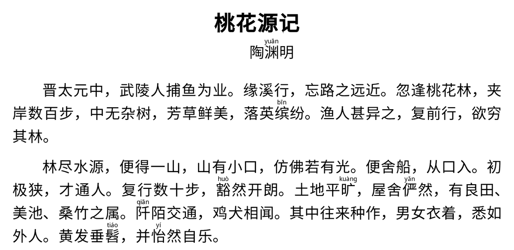
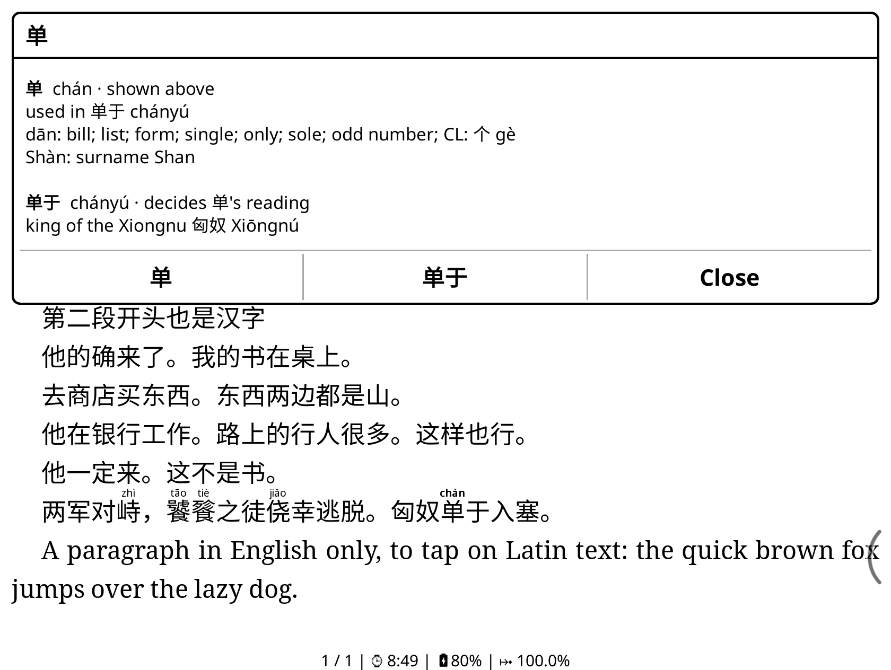
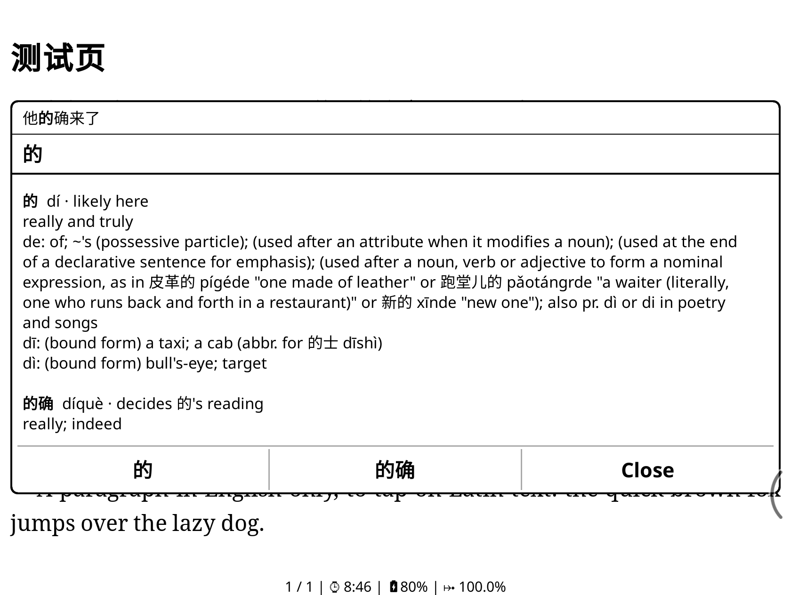
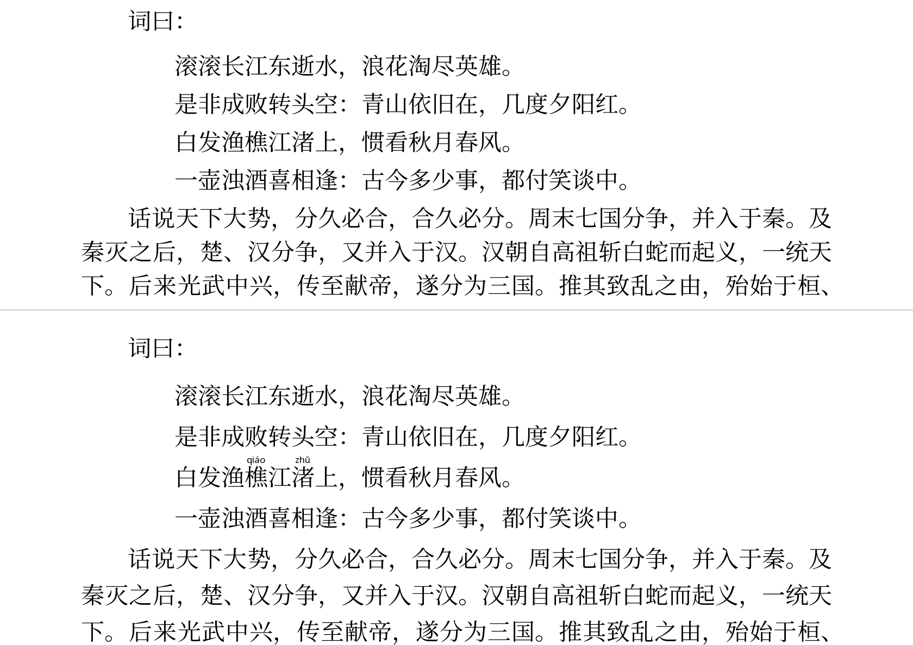

# koreader-chinese-helper

A [KOReader](https://github.com/koreader/koreader) plugin for reading Chinese:

- **Pinyin above rare characters.** Characters outside the N most common get their pinyin drawn
  above them, with the reading worked out from the surrounding word where a character has more
  than one. The book file is never modified.
- **Tap any character for its definition.** A single tap on a Chinese character, or on the
  pinyin above one, opens a popup with that character's CC-CEDICT entry and every dictionary word
  around it that contains it, with one button per word for KOReader's own dictionary lookup.

The popup marks the reading of the character in this sentence, worked out by the same resolver
that draws the pinyin, so the two can never disagree.





It merges two plugins that are no longer developed:
[koreader-interlinear-pinyin](https://github.com/scartoon/koreader-interlinear-pinyin) (the pinyin)
and [koreader-chinese-popup](https://github.com/scartoon/koreader-chinese-popup) (the popup). One
plugin means one tap handler, one popup for every character, and one database.

Status: **1.4.0**, tested on a Boox Go 7 (Android, 300 dpi) with KOReader v2026.07.1.

## Install

1. Download `chinesehelper.koplugin.zip` from the
   [latest release](https://github.com/scartoon/koreader-chinese-helper/releases/latest) and unzip
   it. You get a `chinesehelper.koplugin` folder, which includes the database
   (`data/chinesehelper.sqlite`, about 20 MB).
2. Copy that folder into KOReader's `plugins` folder:
   - **Android** (Boox and others): `/sdcard/koreader/plugins/`, which appears as
     `koreader/plugins` in the device's internal storage over USB. With adb:
     `adb push chinesehelper.koplugin /sdcard/koreader/plugins/`
   - Other devices: the `plugins` folder inside KOReader's own folder.
3. Restart KOReader.

The folder must keep its name, `chinesehelper.koplugin`. The repository does not contain the
database (see [Data](#data)); to install from a clone, build it first.

### Moving from the two old plugins

1. Delete `interlinearpinyin.koplugin` and `chinesepopup.koplugin` from KOReader's `plugins`
   folder, install this one, and restart KOReader.
2. That's all: on its first start the plugin copies your settings from both (pinyin on or off,
   the frequency threshold, pinyin size, uncertain readings, unusual readings, and whether the
   popup is on). Your old settings are left in place, and neither old plugin had per-book
   settings.

While either old plugin is still installed, Chinese helper shows a message asking you to remove
it: both listening for taps on Chinese characters means a tap can open the wrong popup.
"Tap annotated character for definitions" from the pinyin plugin has no successor: "Tap
characters for popup" now covers every character, annotated or not.

## Usage

Open a book (EPUB, FB2, MOBI, HTML, TXT and other reflowable formats), then **Tools (🔧) →
Chinese helper** (the entry may be on the second page of the Tools menu). Settings apply to
all books.

| Menu item | |
|---|---|
| Show pinyin above rare characters | On / off (off when first installed) |
| Tap characters for popup | On / off (on when first installed) |
| Which characters | Pinyin for characters outside the 1,500 / 2,500 / 3,500 / 5,000 / 7,000 most common (default 3,500) |
| Pinyin size | 35–55% of the book's text size (default 40%) |
| When the reading is uncertain | Show both readings (default) / show the most likely reading / don't annotate |
| Mark unusual readings of common characters | On (default) / off. See [Unusual readings](#unusual-readings-of-common-characters) |
| Edge pass-through width | 0 mm (off) / 2.5 mm / 5 mm (default) / 7.5 mm / 10 mm. See [The edge band](#the-edge-band) |
| Popup text size | 40 / 60 (default) / 80 / 100 / 120% of the book's text size |
| Fallback dictionaries | Source labels (all entries / other dictionaries only, the default / none); then each dictionary on/off, in priority order: Wiktionary, CBDB office titles, MOE 重編國語辭典, Wikipedia titles, Moegirlpedia slang (CBDB, MOE and Moegirlpedia only when you have installed their files). See [Other dictionaries](#other-dictionaries) |
| Status | Version, data versions and load times, what the current page needed, and any old plugin still installed |

The two switches are independent: pinyin without the popup, the popup without pinyin, or both.

### What a tap does

- **A single tap on a Chinese character's glyph** (CJK Unified Ideographs, all extensions, and
  the compatibility ideographs), **or on the pinyin drawn above one**, opens the popup, unless
  it is within the edge band (below).
- **Every other tap is KOReader's as usual**: margins, the space between lines, blank space after
  a paragraph, punctuation, Latin text and digits turn the page or open the menus. Taps on links
  and on your highlights keep their usual behaviour.
- **Long-press and every other gesture are untouched**, so KOReader's long-press dictionary and
  text selection work as before.
- PDF and DjVu are not supported: there, every tap is KOReader's and no pinyin is drawn.

### The edge band

A single tap within a set distance of any edge of the screen always goes to KOReader (page turn,
menus, corner actions), even when it lands on a Chinese character or on pinyin. That keeps page
turns reliable when the text runs close to the edges, for example with small page margins.

Set the width with **Edge pass-through width**:

| Choice | Band on a 300 dpi screen | |
|---|---|---|
| 0 mm (off) | none | Only taps that miss a character go to KOReader. |
| 2.5 mm | 30 px | |
| 5 mm (default) | 59 px | |
| 7.5 mm | 89 px | |
| 10 mm | 118 px | |

- The band runs along all four edges, measured from the screen's edges as it is currently held,
  so it follows rotation.
- Millimetres are converted with the screen DPI KOReader reports (shown under **Status**), so
  the band is the same physical size on any device; a screen that reports no DPI is taken as
  300 dpi.
- A change applies to the next tap; no restart is needed.
- KOReader's own menu and corner tap zones reach further than the band (the top and bottom
  menus cover an eighth of the screen height, a fifth across the middle half). Inside those zones
  but outside the band, a tap on a character opens the popup rather than KOReader's menu; tap
  in the band, or on blank space, punctuation or a margin, to open the menus.

### The popup

The plugin reads up to 7 Chinese characters before and after the tapped one (stopping at
punctuation, a paragraph break or any non-Chinese character) and looks up every 1–8 character
stretch containing the tapped character, against both simplified and traditional forms.

- **The tapped character first**, with all its readings. The reading it has here comes first,
  marked **· shown above** when its pinyin is drawn, or **· likely here** when not. When nothing
  decides between a character's two likely readings (see [Readings](#readings)), both are
  marked **· one of these**, the likelier first.
- **Then every dictionary word containing it**, longest first; words of the same length in
  reading order. A word with several readings (东西 *dōngxī* "east and west" / *dōngxi*
  "thing") has the likely one marked and first.
- **The word that decides the reading** is tagged **· decides X's reading**, also when
  CC-CEDICT does not have it (a word from pypinyin's phrase list, or an unusual-reading word
  with a short note, such as 冒顿 *mò dú*).
- **Buttons**: one per entry, labelled with the character or word, which opens KOReader's
  dictionary lookup for it, and **Close**. Tapping outside the popup also closes it.
- **Translate the sentence**: a full-width button on its own row below them, shown only while
  Wi-Fi is on and connected (see below).
- Words CC-CEDICT does not have can come from other dictionaries (below). If no dictionary has
  the character or any word around it, the tap goes straight to KOReader's dictionary lookup.

### Translating the sentence

While Wi-Fi is on and connected, the popup has one more button on a row of its own. It closes
the popup and sends **the whole sentence containing the tapped character**:

- **With [KOAssistant](https://github.com/zeeyado/koassistant.koplugin) installed**, the button
  reads **Translate & Analyze** and runs the sentence through KOAssistant with a built-in prompt:
  a natural English translation, then a chunk-by-chunk analysis (characters, pinyin with tone
  marks, a literal gloss and the grammatical role), then any construction that governs the
  sentence. The sentence goes to KOAssistant as a selection, exactly as if you had selected it
  and run an action from the highlight menu, so KOAssistant also gets its surrounding context,
  your provider and model, and the book's title. The prompt is part of this plugin, a **snapshot**
  of the author's own KOAssistant custom action "Translate & Analyze" (system prompt,
  temperature 0.3, up to 2000 tokens): it works without that custom action, and editing a
  custom action of your own does not change this button. Nothing is written to KOAssistant's
  settings or files.
- **Without KOAssistant** (or with a version whose internals have changed), the button reads
  **Translate** and uses **KOReader's built-in translator**, the same as Translate in the
  highlight menu, with its usual window. KOReader translates from the book's language when
  "Translate from book language" is on: a Chinese book whose metadata says English (common with
  converted EPUBs) comes back untranslated. Fix the book's language in Book information
  (zh-CN), or turn that option off.

The label is decided when the popup opens, so it always says what the button will do. Without
Wi-Fi (off, or on but not connected) the row is left out altogether. The check reads KOReader's
network state only, with no lookup or request, so the popup opens as fast as before; a
connection lost after the popup opens is left to KOReader or KOAssistant.

**The sentence** is found in the book's text, not on the lines on screen, and crosses pages:
forward to the next 。！？ (or . ! ? in Latin text, when followed by a space or the end), with
any closing quotes or brackets right after it (。” ？」 ！』); backward to just after the
previous one, or to the start of the paragraph. A paragraph with no end mark is taken whole.
At most **200 characters** go out: a longer sentence is kept to 200 around the tapped
character (centred, or shifted when it is near one end), each cut end moved inward to a
clause mark (，；：) when there is one close by. Nothing is highlighted in the book.

### Other dictionaries

For words CC-CEDICT does not have, the popup also looks in other dictionaries. Two are part of
the plugin:

- **Wiktionary**: about 61,000 words, many of them historical and literary terms, chengyu,
  technical terms and some slang.
- **Wikipedia titles**: about 39,000 Chinese Wikipedia article titles of 3–8 characters in
  technology, engineering, military and history (红夷大炮 *Hongyipao*, 火绳枪 *Matchlock*,
  鱼鳞册 *Fish-Scale Registers*), glossed with the English article's title.

Three more are files you build and install yourself, because their licences do not allow this
project to distribute them (see [Data](#optional-dictionaries-you-build-yourself)):

- **CBDB office titles**: about 2,900 Ming and Southern Ming office titles with English
  translations (典史 *Clerk / District Jailor*, 巡按御史 *Regional Inspector*).
- **MOE 重編國語辭典**: about 90,000 entries, monolingual, strong on historical and literary
  vocabulary.
- **Moegirlpedia slang**: about 400 internet-slang terms from 萌娘百科, each with its opening
  sentence or two in Chinese (问题不大, 王八之气, 大杀器).

CC-CEDICT always comes first: a word it has never gets an entry from another dictionary. After
it, each word shows the entry of the first dictionary that has it, in this order: Wiktionary,
CBDB, MOE, Wikipedia titles, Moegirlpedia. (CBDB's narrow office titles beat MOE's general
definitions; an English article title is a label rather than a definition, so it comes after
the real dictionaries; Moegirlpedia is only for words nothing else has.) The order is the
`chinesehelper_fallback_order` setting in KOReader's `settings.reader.lua`, which you can edit
while KOReader is closed (e.g. `"moe,wikt"`: dictionaries left out keep their default place
after those named).

- An entry from another dictionary shows that dictionary's own reading (MOE's are Taiwan
  standard; CBDB's have no tone marks) and is never marked *shown above* or *likely here*: those
  markers come from the reading resolver and appear on CC-CEDICT entries only, so the popup and
  the pinyin always agree. Wikipedia and Moegirlpedia give no readings: the popup shows one
  generated with pypinyin, marked *generated pinyin*. A word that decides the reading but is
  missing from CC-CEDICT shows the other dictionary's definition, still tagged *decides X's
  reading*.
- A Wiktionary word can decide a reading in one case: the character's reading is uncertain
  and nothing else decides it (see [Readings](#readings)), as 累世 does for 累 in 累世公卿.
  The other dictionaries' words never decide readings.
- A small grey line above an entry names its dictionary: **CEDICT**, **Wikt**, **CBDB**,
  **MOE**, **WP** or **Moegirl**. By default only entries from the other dictionaries are
  labelled; **Source labels** can label every entry or none.
- Each dictionary can be switched off under **Fallback dictionaries**; with all of them off the
  popup shows CC-CEDICT alone, as before. **Status** lists each dictionary's version and size, or
  that it is not installed.

The popup is the full width of the screen (minus a small margin) and as tall as its content,
up to the full screen height, scrolling beyond that. A short popup goes in the half of the
screen away from the tapped character, so the text stays visible. A taller one starts with the
phrase around the character, the character in bold:



### Readings

Readings are dictionary readings: 一 is *yī* and 不 is *bù* everywhere, as in CC-CEDICT, without
the spoken tone changes (一定 *yídìng*, 不是 *búshì*). In the pinyin drawn above rare
characters, a word's neutral tone shows as the character's own tone (刺猬: *wèi* over 猬).

For each character, in order: an unusual reading in a listed name or term (单于 *chán yú*), if
that option is on; the longest dictionary word around it (侥 is *jiǎo* in 侥幸 but *yáo* in
僬侥; when two words overlap, the more common one); a context rule for the character next to it
(about 950, learned from labelled sentences); its most frequent reading. For the about 530
characters whose most frequent reading is unreliable, a Wiktionary word around it (one CC-CEDICT
lacks) can pick one of the two likeliest readings, while that dictionary is on; Wiktionary words
decide nothing else, since letting them override rules or reliable defaults broke more readings
than it fixed. Characters whose reading stays uncertain show both likely readings, or the most
likely, or none (the menu). Measured on
held-out labelled sentences, about 99.7% of the pinyin drawn in ordinary text is right; see
[Accuracy](https://github.com/scartoon/koreader-interlinear-pinyin#accuracy).

The popup's markers use the same resolver on the same page, for every character, common ones
included (的 is *dí* in 的确, *de* or *dì* on its own; 行 is *háng* in 银行, *xíng* in 行人). On
held-out labelled sentences built around the 1,000 most common characters' hard cases (those with
several readings), the marked reading is right 97.3% of the time (98.1% counting both of an
uncertain pair).
Some word-level choices need the meaning, which the plugin does not have: 东西 is always marked
*dōngxi* ("thing"), also where it means "east and west".

### Line spacing

The pinyin goes in the space between lines, so while it is on the plugin sets a line height that
leaves room for it, taking KOReader's line-spacing setting into account. Turning it off restores
the book's own spacing (KOReader lays the book out again, which takes a moment).



Books with tight spacing get more pages; books that already set generous spacing can end up with
tighter lines, because the plugin replaces the book's line height rather than adding to it.

### Unusual readings of common characters

Common characters are never annotated, but some take a rare reading in particular words, mostly
historical names, titles and places: 单于 *chán yú*, 冒顿 *mò dú*, 龟兹 *qiū cí*, 尉迟 *yù chí*,
番禺 *pān yú*. With **Mark unusual readings of common characters** on, the plugin knows about
190 such words (65 hand-checked) and draws, in bold, only the characters whose reading there
differs from their usual one. A guard keeps them from matching by accident: 订单于3日发货 is
订单 + 于, not 单于.

## Speed

Measured on a Boox Go 7 against the two old plugins, same book, same pages:

- **Page turns**: the pinyin for a page takes 13.4 ms on average to work out, against
  interlinear-pinyin 0.5.0's 13.7 ms; the pages drawn were pixel-for-pixel the same until 1.4.0's
  Wiktionary readings. The words a page can need are read into memory with the other reading
  tables when the first page is drawn; the only query a page can make is one Wiktionary lookup,
  and only when an uncertain rare character on it is left undecided (results are cached) (about 230 ms, once per KOReader session; 0.5.0 took
  190–270 ms to read its text files).
- **A tap**: from the tap to the popup built, 14.7 ms median (16.9 ms mean) with Wiktionary and
  the MOE dictionary, against 13.8 ms (16.6 ms) without them: one query to CC-CEDICT, then one to
  each other dictionary for the words CC-CEDICT does not have. The first tap after opening a book
  takes 20–30 ms either way; the MOE file opens on the first tap, in 1–3 ms. Memory: about
  2 MB more (KOReader's total about 133 MB against 131 MB); the dictionaries are read from the
  database, not loaded into memory.
- **The Translate button**: the Wi-Fi check and the choice of mode take 1–2 ms when the popup
  opens (popup built in 9–15 ms against 7–10 ms without the button, same character). The
  sentence is found when the button is pressed, in 2–3 ms.

## Data

Everything is in one SQLite database, `chinesehelper.koplugin/data/chinesehelper.sqlite` (about
33 MB):

- **CC-CEDICT** (`entries`): the popup's dictionary.
- **Fallback dictionaries** (`fallback`): entries from English **Wiktionary** for words CC-CEDICT
  does not have (about 61,000 headwords: historical and literary terms, chengyu, technical terms,
  some slang), and **Chinese Wikipedia titles** (about 39,000: articles of 3–8 characters with an
  English article, in a technology, engineering, military or history category; people, lists,
  disambiguation pages, places, organisations, works, living things and chemical compounds left
  out). CC-CEDICT always wins: there is no fallback row for any headword CC-CEDICT has, in
  either script. Only what the popup can match is kept (headwords of 1–8 Chinese characters with a
  Mandarin reading), and everyday combinations that CC-CEDICT leaves out on purpose are filtered
  out (很多, 这次, 一天, 脸上: a closed-class word such as a numeral, measure word, adverb, locative
  or particle next to a word CC-CEDICT has), as are numerals and entries that only name places.
- **The reading tables** (every character's frequency rank and default reading, words, context
  rules, uncertain characters, unusual readings). The fallback dictionaries never feed these: the
  build records a checksum of them, which is the same with and without the fallback table. (At
  run time, Wiktionary's words can settle an uncertain character; see [Readings](#readings).)

The popup's lookups use indexes on the simplified and traditional forms; the build checks with
`EXPLAIN QUERY PLAN` that every lookup query uses its index.

### Optional dictionaries you build yourself

Three more fallback dictionaries can be added, each as a separate file. Their licences allow
copying them for your own use but not this project's distributing them, so none is in the
repository or the release: you build the files yourself and copy them to your device. The plugin
works the same without them, and opens each only if it is there. Build the plugin database first
(or use the one from the release zip): headwords CC-CEDICT has are left out of these files too.

```sh
.venv/bin/pip install opencc pypinyin
.venv/bin/python tools/build_moe.py              # -> build/chinesehelper-moe.sqlite (about 17 MB)
.venv/bin/python tools/build_cbdb.py             # -> build/chinesehelper-cbdb.sqlite (about 0.5 MB)
.venv/bin/python tools/build_moegirl.py          # -> build/chinesehelper-moegirl.sqlite (under 0.1 MB)
# add --push to any of them to copy the file to a USB-connected Android device (adb)
```

They go in KOReader's data folder, where plugin updates leave them alone:
`koreader/data/chinesehelper/` (on Android: `/sdcard/koreader/data/chinesehelper/`).

- **MOE 重編國語辭典**: the Taiwan Ministry of Education's
  [《重編國語辭典修訂本》](https://dict.revised.moe.edu.tw/) (about 160,000 entries, monolingual),
  from [g0v/moedict-data](https://github.com/g0v/moedict-data) (downloaded, 7 MB). Licence:
  [CC BY-ND 3.0 TW](https://creativecommons.org/licenses/by-nd/3.0/tw/). Its headwords are
  traditional, also indexed under their simplified form (OpenCC `tw2s`, characters only); its
  readings are Taiwan standard and stay inside its own entries.
- **CBDB office titles**: the Ming and Southern Ming office titles of the
  [China Biographical Database (CBDB)](https://cbdb.hsites.harvard.edu/), with CBDB's English
  translations ("office title (Ming)" where CBDB has none yet) and its toneless readings, from
  CBDB's [SQLite release](https://huggingface.co/datasets/cbdb/cbdb-sqlite) (downloaded, about
  110 MB zipped, 590 MB unzipped). Licence: the
  [CBDB Data Licensing Terms](https://cbdb.hsites.harvard.edu/cbdb-data-licensing-terms)
  ([CC BY-NC-SA 4.0](https://creativecommons.org/licenses/by-nc-sa/4.0/) for the data of the
  standalone release, CBDB's own non-commercial, no-redistribution terms beyond it). This project
  follows the stricter of the two: it ships only the build script, never CBDB data, and the file
  is meant for your own non-commercial reading on your own device. Don't share it.
- **Moegirlpedia slang**: the internet-slang pages of [萌娘百科](https://zh.moegirl.org.cn) (the
  page's opening sentence or two, with 黑幕 and struck-through text removed; a hand-checked list
  of characters, works and plain words left out), from the offline snapshot
  [zhmoegirl-20230507-alpha.slob](https://github.com/aisuneko/dicts_for_aard2/releases/tag/moegirl-alpha)
  (1.4 GB, downloaded; listed on the [slob project's dictionary page](https://github.com/itkach/slob/wiki/Other-projects)).
  Licence: [CC BY-NC-SA 3.0 CN](https://creativecommons.org/licenses/by-nc-sa/3.0/cn/). Reading
  it needs the slob reader, which needs ICU:
  `brew install icu4c pkg-config`, then
  `PKG_CONFIG_PATH=$(brew --prefix icu4c)/lib/pkgconfig .venv/bin/pip install git+https://github.com/itkach/slob.git`.
  Reading every page takes 10–15 minutes.

The glosses of the newer sources (Wikipedia, CBDB, Moegirlpedia) are cleaned of characters
KOReader's fonts may not draw: emoji, kaomoji, decorative symbols and scripts other than Latin
and CJK (Greek letters are spelt out: α → alpha).

The database changes completely with each CC-CEDICT update, so it is **not committed** (every
rebuild would add another 20 MB of binary history); it is attached to each GitHub release inside
the ready-to-install zip. The small hand-made and learned inputs it is built from are in
[`data/`](data/README.md).

To rebuild it (Python 3):

```sh
python3 -m venv .venv && .venv/bin/pip install wordfreq==3.1.1 pypinyin==0.55.0 lupa
.venv/bin/python tools/build_db.py                 # downloads the current CC-CEDICT
.venv/bin/python tools/build_db.py --cedict build/cedict_1_0_ts_utf-8_mdbg.txt.gz   # or a local copy
.venv/bin/python tools/build_db.py --learn         # also re-learn the context rules (downloads the CPP dataset)
.venv/bin/python tools/build_db.py --no-wiktionary # without the Wiktionary fallback rows
.venv/bin/python tools/build_db.py --no-wikipedia  # without the Wikipedia title rows
```

The Wiktionary data (kaikki.org's extraction, about 160 MB) and the five Chinese Wikipedia SQL
dumps the titles come from (about 1.1 GB; parsing them takes a few minutes) are downloaded into
`build/sources/` when missing; the build records the dump dates, and the checksums of the other
sources, in the database's `meta` table.

The release ships CC-CEDICT dated 2026-11-09 (125,397 entries), Wiktionary as of the 2026-10-01
dump (kaikki.org extraction of 2026-10-30) and Chinese Wikipedia as of the 2026-11-01 dump;
[`data/README.md`](data/README.md) lists every source's version.

To see what fallback dictionaries add on your own books: `tools/fetch_books.py` (copies the EPUBs
from a USB-connected device into `build/`), `tools/download_sources.sh`, then
`tools/measure_fallback.py` (reports in `build/measure/`). For one book on this computer:
`tools/fetch_books.py --local NAME BOOK.epub` (or a zip of EPUBs), then
`tools/measure_fallback.py --book NAME` and `tools/measure_book.py --book NAME` (what that book still
lacks after every current dictionary, and what candidate sources would add).

## Development

```sh
tools/check.sh                  # luac -p and luajit -b on every Lua file, then the tests
tools/deploy.sh "/sdcard/Books/book.epub"   # check, push to a USB-connected Android device, restart KOReader
.venv/bin/python tools/eval_readings.py     # reading accuracy on the CPP test split (--fallback none: without Wiktionary's words)
.venv/bin/python tools/scan_special.py BOOK.epub   # the unusual readings a book gets
.venv/bin/python tools/make_test_epub.py build/chinesehelper-test.epub   # a book for tap tests on a device
```

The tests (`tests/run.py`, under LuaJIT through lupa) cover the reading resolver, page walking,
layout and hit testing, the popup's content and placement, the sentence finder and the
Translate button (mode, Wi-Fi), the settings migration, the menu, and the database code, which runs its real SQL against the built database. `test_integration.lua`
checks the resolver and the popup together, including that for every character the pinyin layer
draws, the popup marks the same reading.

| File | |
|---|---|
| `main.lua` | lifecycle, menu, data loading, old-plugin check |
| `ch_settings.lua` | settings and the migration from the old plugins |
| `ch_annotator.lua` | the pinyin layer: line spacing, page refresh |
| `ch_page.lua` | walks the page through the rendering engine |
| `ch_resolve.lua` | the reading resolver, for the pinyin and the popup |
| `ch_readings.lua` | the resolver's tables |
| `ch_db.lua` | the database |
| `ch_overlay.lua`, `ch_layout.lua`, `ch_hit.lua` | drawing the pinyin, spacing it, and which pinyin a tap is on |
| `ch_tap.lua` | the one tap handler |
| `ch_context.lua`, `ch_text.lua` | tap → character → the characters around it; candidate words |
| `ch_pinyin.lua` | pinyin comparisons |
| `ch_popup_model.lua`, `ch_popup.lua` | what the popup shows, and the popup |
| `ch_sentence.lua` | the sentence around the tapped character |
| `ch_translate.lua` | the Translate button: KOAssistant (with the prompt snapshot) or KOReader's translator |

## Credits and licences

The annotation code comes from **[WordGloss](https://github.com/GangYe293/wordgloss.koplugin)** by
GangYe293 (GPL-3.0), which koreader-interlinear-pinyin was forked from: the paint layer, layout
and line-height injection (`ch_overlay.lua`, `ch_layout.lua`, parts of `ch_annotator.lua` and
`ch_page.lua`). WordGloss credits its inline-gloss rendering approach to
[inlinehints.koplugin](https://github.com/omer-faruq/inlinehints.koplugin) by omer-faruq.

The code is licensed under the **GNU General Public License v3.0** (see [`LICENSE`](LICENSE)),
like WordGloss and both plugins it merges.

The data (the database, and the files in `data/`) is derived from, and distributed under,
[CC BY-SA 4.0](https://creativecommons.org/licenses/by-sa/4.0/):

- **[CC-CEDICT](https://www.mdbg.net/chinese/dictionary?page=cc-cedict)**, © MDBG and
  contributors, CC BY-SA 4.0: the dictionary, readings and words.
- **[wordfreq](https://github.com/rspeer/wordfreq)** by Robyn Speer, data under CC BY-SA 4.0:
  character and word frequencies.
- **[pypinyin](https://github.com/mozillazg/python-pinyin)** by mozillazg, MIT License: its phrase
  list (words CC-CEDICT lacks) and fallback readings.
- The **[CPP polyphone dataset](https://github.com/kakaobrain/g2pM)** by Kyubyong Park and Seanie
  Lee (Interspeech 2020; repository Apache-2.0, sentences from Chinese Wikipedia, CC BY-SA): its
  train split, for the context rules and uncertain characters. The dataset itself is not
  included.
- **[Wiktionary](https://en.wiktionary.org/)** (English Wiktionary's Chinese entries), by
  Wiktionary contributors, CC BY-SA 4.0, via the
  [kaikki.org](https://kaikki.org/dictionary/Chinese/) extraction made with
  [wiktextract](https://github.com/tatuylonen/wiktextract) (Tatu Ylonen, "Wiktextract: Wiktionary as
  Machine-Readable Structured Data", LREC 2022): the fallback dictionary. Changes made: Mandarin
  readings only, dialect-only senses dropped, redirects resolved, entries CC-CEDICT has and
  everyday combinations left out, senses reformatted; see `data/README.md`.
- **[Chinese Wikipedia](https://zh.wikipedia.org/)**, by Wikipedia contributors, CC BY-SA 4.0,
  from the [Wikimedia dumps](https://dumps.wikimedia.org/zhwiki/): article titles and the titles
  of their English articles (English Wikipedia, CC BY-SA 4.0), for the fallback dictionary.
  Changes made: titles filtered by category and length, converted to both scripts with OpenCC,
  readings generated with pypinyin; see `data/README.md`.

Not distributed, never in the repository or a release; tools in `tools/` build them from the
originals for the user's own device:

- the optional MOE dictionary, [中華民國教育部《重編國語辭典修訂本》](https://dict.revised.moe.edu.tw/)
  (© Ministry of Education, Republic of China (Taiwan),
  [CC BY-ND 3.0 TW](https://creativecommons.org/licenses/by-nd/3.0/tw/)), read from
  [g0v/moedict-data](https://github.com/g0v/moedict-data) (`tools/build_moe.py`);
- the optional CBDB office titles, from the
  [China Biographical Database](https://cbdb.hsites.harvard.edu/) (Harvard University, Academia
  Sinica and Peking University;
  [CBDB Data Licensing Terms](https://cbdb.hsites.harvard.edu/cbdb-data-licensing-terms),
  CC BY-NC-SA 4.0) (`tools/build_cbdb.py`);
- the optional Moegirlpedia slang, from [萌娘百科](https://zh.moegirl.org.cn)
  ([CC BY-NC-SA 3.0 CN](https://creativecommons.org/licenses/by-nc-sa/3.0/cn/)), via a third
  party's offline snapshot (`tools/build_moegirl.py`).

[`data/README.md`](data/README.md) lists the changes made and the versions used. The texts in
the sample book (`samples/guwen.epub`: 陶渊明, 刘禹锡, 周敦颐) are in the public domain.
