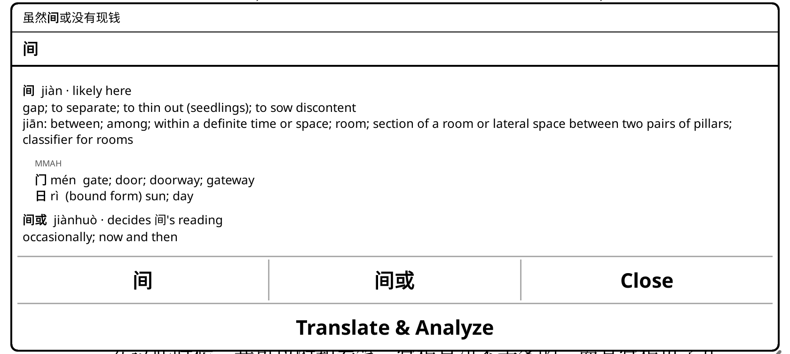
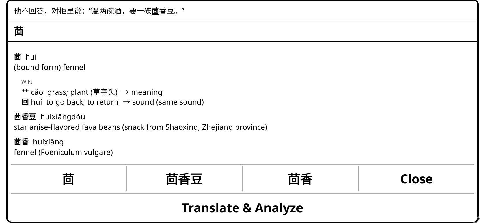
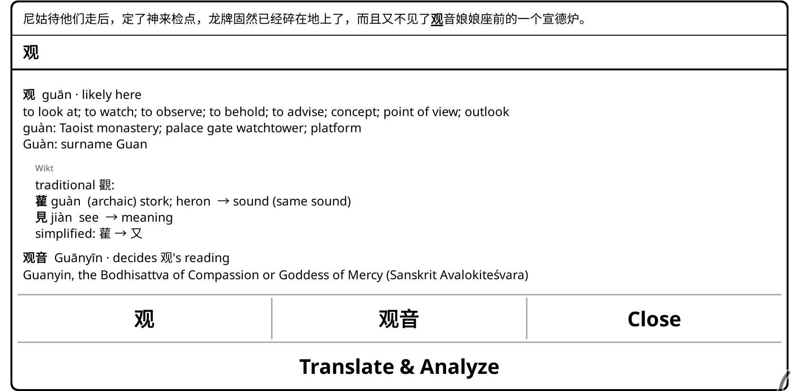
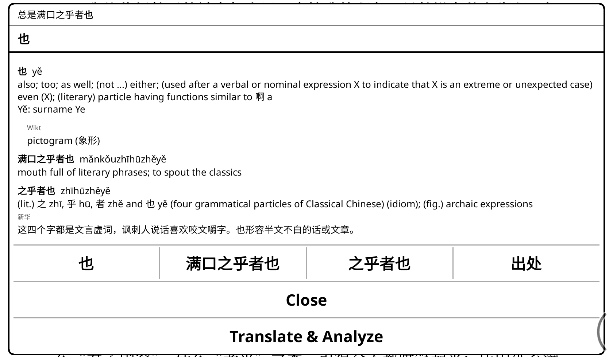
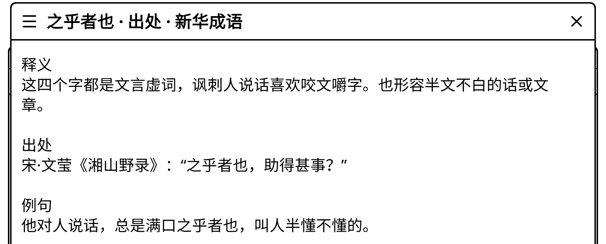
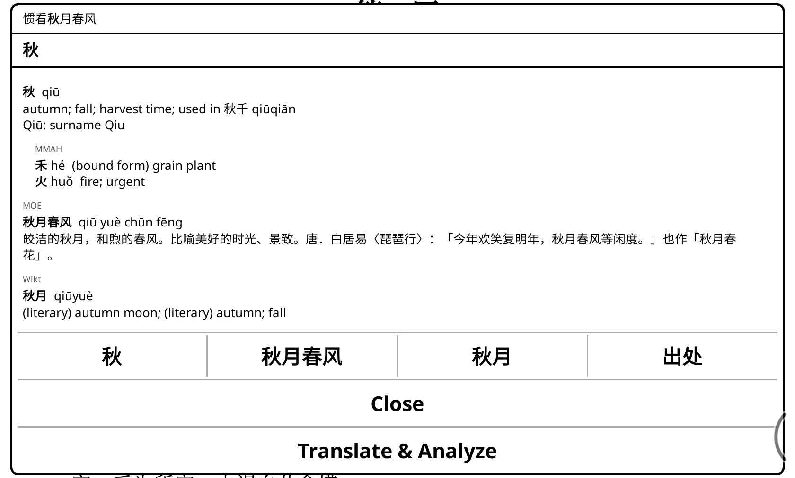
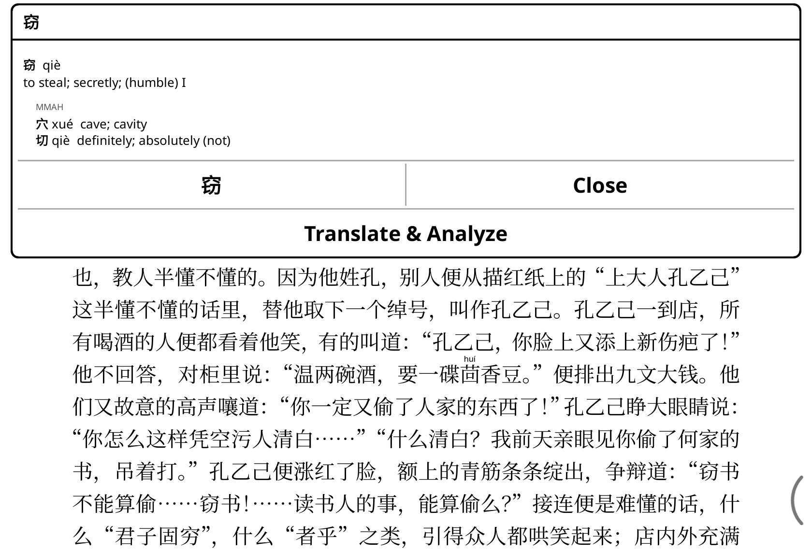

# koreader-chinese-helper

**A [KOReader](https://github.com/koreader/koreader) plugin for reading Chinese: tap any character
and see the words it forms in this sentence, with the reading it has here.**

Chinese has no spaces between words, so an ordinary dictionary lookup means long-pressing,
dragging a selection and guessing where the word ends. Here you tap one character. The plugin
reads the text on both sides of it, finds the dictionary words actually written there, and marks
the reading the character takes in this context: 行 is *háng* in 银行 but *xíng* in 行人 (see
[Readings](#readings)). You can also turn on pinyin, drawn only above characters rarer than a
cutoff you choose: the hard ones get help and the rest of the page stays clean. It works on any
reflowable book (EPUB, FB2, MOBI, TXT and the like) as soon as you open it.


<table>
<tr>
<td width="50%"><a href="#line-spacing"></a><br><b>Pinyin only above the hard characters</b>, at the level you choose (here the default: outside the 3,500 most common)</td>
<td width="50%"><a href="#the-popup"></a><br><b>The reading it has here</b>, and the word that decides it: 间 is <i>jiàn</i> in 间或</td>
</tr>
<tr>
<td><a href="#character-components"></a><br><b>What each character is made of</b>: 茴 is 艹 for the meaning and 回 <i>huí</i> for the sound</td>
<td><a href="#character-components"></a><br><b>Parts the simplification hid</b>: 观 is read through 觀, 雚 <i>guàn</i> → sound</td>
</tr>
<tr>
<td><a href="#chengyu"></a><br><b>Chengyu explained</b>: 之乎者也 with Xinhua's line (optional file) …</td>
<td><a href="#chengyu"></a><br>… and its <b>出处</b>: the classical source and an example (this very line of 孔乙己)</td>
</tr>
<tr>
<td><a href="#fallback-dictionaries"></a><br><b>Several dictionaries, each labelled</b>: CC-CEDICT, then MOE (optional) and Wiktionary for 秋月春风 and 秋月</td>
<td><a href="#translating-the-sentence"></a><br><b>Translate &amp; Analyze the sentence</b> with KOAssistant (while Wi-Fi is on): here 孔乙己's 窃书不能算偷</td>
</tr>
</table>

All screenshots: a Boox Go 7 (landscape), the [sample book](#the-sample-book), default settings,
with every optional dictionary installed. `tools/make_screenshots.py` takes them again.

- **One tap, no selecting**: tap a character, or the pinyin above one; every other tap turns
  pages and opens menus as usual ([What a tap does](#what-a-tap-does)).
- **Only the words on the page**: tap 宛 in 很大宛如 and you get 宛, 大宛 and 宛如, longest first,
  so a sentence that could divide two ways shows both ([The popup](#the-popup)).
- **A reading for every character**, common ones included, right 97.5% of the time on the hard
  cases ([Readings](#readings), [Accuracy](#accuracy)).
- **Five pinyin levels**, from outside the 1,500 to outside the 7,000 most common characters;
  common characters in an unusual reading (单 in 单于) get pinyin too
  ([Unusual readings](#unusual-readings-of-common-characters)).
- **Translate** uses KOReader's built-in translator when KOAssistant is not installed
  ([Translating the sentence](#translating-the-sentence)).
- **Pinyin and popup are separate switches**; nothing is prepared per book, the book file is
  never modified, and long-press and KOReader's own dictionary are untouched.

### Dictionaries

CC-CEDICT comes first; the others, the [fallback dictionaries](#fallback-dictionaries), give
entries for words it lacks. The rows are in the order the popup checks them.

| Dictionary | Label | Entries added | | Mainly covers |
|---|---|---|---|---|
| CC-CEDICT | CEDICT | 125,000 | bundled | modern vocabulary, in English |
| Wiktionary | Wikt | 61,000 | bundled | historical and literary terms, chengyu, technical terms, some slang |
| CBDB office titles | CBDB | 2,900 | [optional](#optional-dictionaries) | Ming and Southern Ming office titles |
| MOE dictionary | MOE | 90,500 (of its 161,000) | [optional](#optional-dictionaries) | historical and literary vocabulary (in Chinese) |
| MOE idioms | 成语典 | 3,700\* | [optional](#optional-dictionaries) | chengyu, with source texts and stories (in Chinese) |
| Xinhua idioms | 新华 | 23,500\* | [optional](#optional-dictionaries) | chengyu and set phrases, with classical sources (in Chinese) |
| Wikipedia titles | WP | 39,000 | bundled | technology, engineering, military and history terms, and proper names (English article title) |
| Moegirlpedia slang | Moegirl | 350 | [optional](#optional-dictionaries) | internet slang (in Chinese) |

\* Chengyu CC-CEDICT lacks. Both files also add a Chinese line and a 出处 view to chengyu the
other dictionaries have: MOE idioms covers 5,470 chengyu in all, Xinhua idioms 30,200
([Chengyu](#chengyu)).

Optional dictionaries are files you build yourself, because their licences do not allow this
project to distribute them. All explanatory text is in simplified characters
([Simplified text](#simplified-text)).

Status: **1.9.2**, tested on a Boox Go 7 (Android, 300 dpi) with KOReader v2026.07.1.

## Install

1. Download `chinesehelper.koplugin.zip` from the
   [latest release](https://github.com/scartoon/koreader-chinese-helper/releases/latest) and unzip
   it. You get a `chinesehelper.koplugin` folder, which includes the database
   (`data/chinesehelper.sqlite`, 36.4 MB).
2. Copy that folder into KOReader's `plugins` folder:
   - **Android** (Boox and others): `/sdcard/koreader/plugins/`, which appears as
     `koreader/plugins` in the device's internal storage over USB. With adb:
     `adb push chinesehelper.koplugin /sdcard/koreader/plugins/`
   - Other devices: the `plugins` folder inside KOReader's own folder.
3. Restart KOReader.

The folder must keep its name, `chinesehelper.koplugin`. The repository does not contain the
database; to install from a clone, [build it](#building-the-database) first.

### Moving from the two old plugins

This plugin replaces
[koreader-interlinear-pinyin](https://github.com/scartoon/koreader-interlinear-pinyin) (the pinyin)
and [koreader-chinese-popup](https://github.com/scartoon/koreader-chinese-popup) (the popup), which
are no longer developed. Delete `interlinearpinyin.koplugin` and `chinesepopup.koplugin` from
KOReader's `plugins` folder, install this one and restart KOReader. On its first start it copies
your settings from both; your old settings are left in place. While either old plugin is
installed, a message asks you to remove it, since two plugins listening for taps can open the
wrong popup. "Tap annotated character for definitions" has no successor: the popup covers every
character.

## Usage

Open a book, then **Tools (🔧) → Chinese helper** (the entry may be on the second page of the
Tools menu). Settings apply to all books.

| Menu item | |
|---|---|
| Show pinyin above rare characters | On / off (off when first installed) |
| Tap characters for popup | On / off (on when first installed) |
| Which characters | Pinyin for characters outside the 1,500 / 2,500 / 3,500 / 5,000 / 7,000 most common (default 3,500) |
| Pinyin size | 35–55% of the book's text size (default 40%) |
| When the reading is uncertain | Show both readings (default) / show the most likely reading / don't annotate |
| Mark unusual readings of common characters (names, historical terms) | On (default) / off. See [Unusual readings](#unusual-readings-of-common-characters) |
| Edge pass-through width | 0 mm (off) / 2.5 mm / 5 mm (default) / 7.5 mm / 10 mm. See [What a tap does](#what-a-tap-does) |
| Popup text size | 40 / 60 (default) / 80 / 100 / 120% of the book's text size |
| Show character components | On (default) / off. See [Character components](#character-components) |
| Fallback dictionaries | Source labels (all entries / other dictionaries only (default) / none); then each dictionary on/off, in order: Wiktionary, CBDB office titles, MOE 重編國語辭典, MOE 成語典, Xinhua idioms, Wikipedia titles, Moegirlpedia slang. See [Fallback dictionaries](#fallback-dictionaries) |
| Status | Version, data versions and load times, each fallback dictionary (version, entries, on or off, or not installed), what the current page needed, and any old plugin still installed |

### What a tap does

- **A single tap on a Chinese character's glyph** (CJK Unified Ideographs, all extensions, and
  the compatibility ideographs), **or on the pinyin drawn above one**, opens the popup.
- **Every other tap is KOReader's**: margins, the space between lines, blank space after a
  paragraph, punctuation, Latin text and digits turn the page or open the menus. Links and your
  highlights keep their usual behaviour; long-press and every other gesture are untouched.
- **The edge band**: a tap within **Edge pass-through width** of any screen edge always goes to
  KOReader, even on a character, so page turns stay reliable with small margins. The width is
  converted with the screen DPI KOReader reports (300 dpi if it reports none, where 5 mm is
  59 px), follows rotation, and applies from the next tap.
- KOReader's menu and corner zones reach further than the band: inside them, a tap on a character
  opens the popup; tap in the band, or on blank space or punctuation, to open the menus.
- PDF and DjVu are not supported: there, every tap is KOReader's and no pinyin is drawn.

### Line spacing

The pinyin goes in the space between lines, so while it is on the plugin sets a line height that
leaves room for it, taking KOReader's line-spacing setting into account. Turning it off restores
the book's own spacing (KOReader lays the book out again, which takes a moment).


Books with tight spacing get more pages; books that already set generous spacing can end up with
tighter lines, because the plugin replaces the book's line height rather than adding to it.

### The popup

The plugin reads up to 7 Chinese characters before and after the tapped one (stopping at
punctuation, a paragraph break or any non-Chinese character) and looks up every 1–8 character
stretch containing the tapped character, in simplified and traditional forms. Nothing guesses
where the words break.

- **The tapped character first**, with all its readings. The reading it has here comes first,
  marked **· shown above** when its pinyin is drawn, or **· likely here** when not. When nothing
  decides between its two likely readings, both are marked **· one of these**, the likelier
  first ([Readings](#readings)).
- **The character's components**, indented under its own entry ([below](#character-components)).
- **Then every dictionary word containing it**, longest first; words of the same length in
  reading order. A word with several readings (东西 *dōngxī* "east and west" / *dōngxi*
  "thing") has the likely one marked and first.
- **The word that decides the reading** is tagged **· decides X's reading**, also when CC-CEDICT
  does not have it: then it shows a fallback dictionary's definition, or the short note of an
  unusual-reading word (冒顿 *mòdú*), or only its reading (a word from pypinyin's phrase list).
- **Buttons**: one for each entry, labelled with the character or word, which looks it up in
  KOReader's dictionary; **出处** for a chengyu with a source view; **Close**; and, on a row of its
  own while Wi-Fi is connected, **Translate** ([below](#translating-the-sentence)). Tapping
  outside the popup also closes it.
- If no dictionary has the character or any word around it, the tap goes straight to KOReader's
  dictionary lookup.

The popup is the full width of the screen (minus a small margin) and as tall as its content, up
to the full screen height, scrolling beyond that. A short popup goes in the half of the screen
away from the tapped character, so the text stays visible. A taller one starts with the phrase
around the character, the character in bold:


### Character components

Every single-character popup shows what the character is made of, one line per part, below the
character's own entry (髡 *kūn*: 髟 *biāo* hair → meaning; 兀 *wù* → sound, loose).

- **Each part** shows its form as written, its modern reading, a short gloss and its role.
  Radical forms are read as their full character, with the common name: 氵 *shuǐ* water
  (三点水), 钅 *jīn* metal (金字旁). 阝 is 阜 on the left (左耳旁: 陈) and 邑 on the right (右耳旁: 郎).
- **Sound parts** say how well they still match: **same sound** (tone aside: 茴 / 回 *huí*),
  **same ending** (same final, medial aside: 郎 *láng* / 良 *liáng*), or **loose** (髡 *kūn* / 兀
  *wù*). Among characters outside the 2,500 most common with a sound part, about 56% are same
  sound, 20% same ending and 23% loose.
- **Ideogrammic compounds** mark every part → meaning (武: 戈 + 止); a **pictogram** or
  **indicative** character says so (象形, 指事).
- **Simplified characters** whose simplification hid a part show the traditional form's parts,
  then what replaced them (观: traditional 觀, 雚 *guàn* → sound; simplified: 雚 → 又). Where it
  only writes the same parts the simplified way (铳 from 銃, 陈 from 陳), the simplified forms are
  shown with the traditional form's roles. A character with several traditional forms (发: 發,
  髮) takes the one of the word it was tapped in, as CC-CEDICT writes it (头发: 髮; 发现: 發).
- **Sources**, in this order and labelled: **Wikt**, English Wiktionary's `Han compound`
  analysis (the first, where it records several; some describe an older form: 期, semantic 日
  from 㫷); **MMAH**, [Make Me a Hanzi](https://github.com/skishore/makemeahanzi), without its
  learner mnemonics (often wrong for simplified characters: 观 "to see 见 again 又") and without
  roles for its often-wrong "ideographic" parts, unless its note names the sound part (钺: 戉);
  **IDS**, [yi-bai/ids](https://github.com/yi-bai/ids), the structure alone (龘: 龍 + 龖).
- **Readings and glosses** of the parts come from CC-CEDICT, or Wiktionary's gloss of the sense
  a part contributes (見 "see"). A sound part takes the reading that best matches the character
  (雚 *guàn* "stork", not its default *huán*).
- **Nothing undisplayable**: an analysis with a character outside Unicode's Basic Multilingual
  Plane, which KOReader's fonts would draw as a box, gives way to the next source's (秋:
  Wiktionary's 禾 + 𤒅, then Make Me a Hanzi's 禾 + 火).

Coverage of the characters in the frequency list:

| Most common | Wikt | MMAH | IDS (structure) | None |
|---|---|---|---|---|
| 1–2,500 | 79% | 12% | 5% | 4% |
| 2,501–3,500 | 66% | 23% | 6% | 5% |
| 3,501–5,000 | 50% | 36% | 9% | 5% |
| 5,001–7,000 | 30% | 40% | 23% | 7% |
| beyond 7,000 | 17% | 18% | 56% | 8% |

Characters with none are mostly those whose only analyses contain undisplayable characters.

### Chengyu

With the optional MOE idioms or Xinhua idioms file installed, a chengyu in the popup gets more
than CC-CEDICT's English gloss:

- **One line of Chinese explanation** under CC-CEDICT's (or Wiktionary's) entry, with its own
  small label: 一毛不拔 → *形容人非常吝啬。贬义。* (成语典). It comes from MOE idioms when it has
  the chengyu, otherwise from Xinhua idioms. Entries already in Chinese get no extra line.
- **A 出处 button** opens a full-screen view. From MOE idioms: 释义, the 典源 passage with its
  notes, 典故说明 (the story retold in modern Chinese), 书证, usage, examples, 辨识 and near and
  opposite idioms; a related form (玉石俱碎) adds its main idiom's source and story under that
  idiom's name. From Xinhua idioms: the explanation, the classical source and an example. MOE
  idioms comes first when both have it; with several chengyu in one popup, each button is named
  (首鼠两端 出处). There is no button when there is nothing beyond the one line.
- **Chengyu CC-CEDICT lacks** (精兵强将, 科班出身, 十二万分) get an entry from these files, in the
  [fallback order](#fallback-dictionaries).

Their readings appear only on their own entries and never decide the pinyin drawn. Measured with
`tools/measure_chengyu.py` on the 46 Chinese books on the test device (202,036 chengyu
occurrences) and on 临高启明 (38,398):

| Popup | 46 books | 临高启明 |
|---|---|---|
| an entry, bundled dictionaries only | 93.2% | 93.7% |
| an entry, with the MOE dictionary | 97.3% | 97.7% |
| an entry, with the MOE dictionary, MOE idioms and Xinhua idioms | 100% | 100% |
| a Chinese short line | 94.7% | 94.6% |
| a 出处 view | 92.4% | 92.3% |
| a 出处 view from MOE idioms | 30.3% | 28.9% |

A chengyu here is any headword CC-CEDICT tags *idiom* or either file lists, so "100%" only means
the two files cover their own lists; the gain is the 1,282 chengyu (5,397 occurrences) that had
no entry even with the MOE dictionary, such as 精兵强将, 受制于人, 由来已久.

### Translating the sentence

While Wi-Fi is on and connected, the popup has one more button on a row of its own. It closes the
popup and sends **the whole sentence containing the tapped character**:

- **With [KOAssistant](https://github.com/zeeyado/koassistant.koplugin) installed** (tested with
  0.23.0; the button uses its internals, so a later version may fall back to the built-in
  translator), it reads **Translate & Analyze**: a built-in prompt asks for a natural English
  translation, a chunk-by-chunk analysis (characters, pinyin, a literal gloss, the grammatical
  role) and any construction that governs the sentence. The sentence goes to KOAssistant as a
  selection, so it also gets the surrounding context, your provider and model, and the book's
  title. The prompt is a snapshot of the author's own custom action (temperature 0.3, up to 2000
  tokens): your custom actions do not change it, and nothing is written to KOAssistant's
  settings.
- **Without KOAssistant**, it reads **Translate** and uses **KOReader's built-in translator**.
  With "Translate from book language" on, a Chinese book whose metadata says English (common
  with converted EPUBs) comes back untranslated: set its language to zh-CN in Book information,
  or turn that option off.

The row is left out without a Wi-Fi connection; the check reads KOReader's network state only.

**The sentence** is found in the book's text, across pages: forward to the next 。！？ (or . ! ?
followed by a space) with any closing quotes after it (。” ？」), backward to just after the
previous one or the start of the paragraph. At most **200 characters** go out: a longer sentence
is cut around the tapped character, at a clause mark (，；：) when there is one close by.

## Readings

Each character's reading is decided by the first of these that applies:

1. **An unusual-reading word** around it (单于 *chányú*), if
   [that option](#unusual-readings-of-common-characters) is on.
2. **A dictionary word of 2–4 characters** around it, from CC-CEDICT or pypinyin's phrase list:
   侥 is *jiǎo* in 侥幸 but *yáo* in 僬侥. When two words overlap, the more common one (by
   [wordfreq](https://github.com/rspeer/wordfreq)) wins. Longer words in the popup, up to 8
   characters, do not decide readings.
3. **A context rule** for the character next to it: 952 rules, learned from labelled Wikipedia
   sentences.
4. **A Wiktionary word**, for uncertain characters only: for the 535 characters whose most
   frequent reading is unreliable, a Wiktionary word around it can pick one of the two likeliest
   readings (累世 for 累 in 累世公卿), while that dictionary is on. Wiktionary words decide
   nothing else, since letting them override rules or reliable defaults broke more readings than
   it fixed.
5. **The character's most frequent reading.**

Particles take their neutral reading by default (吧 *ba*, 啦 *la*, 得 *de*), since their toned
readings live in words (酒吧 *jiǔbā*, 啦啦队, 得到 *dédào*). An uncertain character that nothing
decides gets both likely readings, the most likely one, or none, as **When the reading is
uncertain** says. The popup marks the same reading as the pinyin, for every character, common
ones included (的 is *dí* in 的确, *de* or *dì* on its own). Some choices need the meaning, which
the plugin does not have: 东西 is always marked *dōngxi* ("thing"), also where it means "east and
west".

Readings are dictionary readings: 一 is *yī* and 不 is *bù* everywhere, without the spoken tone
changes (一定 *yídìng*). Where CC-CEDICT gives a word's syllable only as a neutral tone, that is
drawn above a rare character (刺猬 *cìwei*, 鼓捣 *gǔdao*, 疙瘩 *gēda*), and its popup entry (猬
*wèi*) is marked with the same letters. Where CC-CEDICT lists the word both ways (大爷 *dàyé*
"idler" / *dàye* "uncle"), the toned reading is drawn and the popup marks the neutral one.

What is drawn on a page:

- A character gets pinyin only the first time it appears on the page with a given reading: later
  repeats are left bare, but a repeat with a different reading (刨 *páo* in 刨根, then *bào* in
  刨子) is annotated again.
- When a line is too crowded for all its pinyin to fit, the pinyin of the line's most common
  annotated character is dropped first, and so on until the rest fit; the rarest are kept.

### Unusual readings of common characters

Common characters are never annotated, but some take a rare reading in particular words, mostly
historical names, titles and places: 单于 *chányú*, 冒顿 *mòdú*, 龟兹 *Qiūcí*, 尉迟 *Yùchí*,
番禺 *Pānyú*. With **Mark unusual readings of common characters** on, the plugin knows about 300
such words (65 hand-checked) and draws, in bold, only the characters whose reading there differs
from their usual one. A guard keeps them from matching by accident: 订单于3日发货 is 订单 + 于,
not 单于.

## Accuracy

`tools/eval_readings.py` runs the plugin's own resolver over the test split of the
[CPP polyphone dataset](https://github.com/kakaobrain/g2pM) (labelled sentences from Chinese
Wikipedia; the context rules are learned from its train split only). CPP holds only characters
with several readings, so it is the hard case.

| Pinyin for characters outside | Characters tested | Most likely reading right | Right counting both of a pair | Shown as a pair | Estimated, ordinary text (both shown) |
|---|---|---|---|---|---|
| 1,500 most common | 5,353 | 95.9% | 97.6% | 7.2% | 99.56% |
| 2,500 | 3,189 | 96.2% | 97.8% | 8.0% | 99.61% |
| 3,500 (default) | 1,482 | 96.0% | 97.6% | 10.7% | 99.67% |
| 5,000 | 260 | 95.4% | 98.8% | 28.8% | 99.84% |
| 7,000 | 42 | 97.6% | 100.0% | 45.2% | 100.00% |

The last column weights every character the plugin would draw by how often it occurs in ordinary
text (wordfreq), counting characters with a single reading as right. It is an estimate from
Wikipedia sentences, not a count on books, and it leans pessimistic, since CPP over-represents
minority readings. The popup's markers on the 1,000 most common characters (3,687 test examples)
are right 97.5% of the time, 98.2% counting both of a pair. CPP labels some neutral-tone words
with the full tone (枇杷 *pá*, 收拾 *shí*), which counts against the plugin's spoken form. Unusual
readings agree with CPP's label in 25 of the 36 test sentences that contain one; 8 of the 11
others are the place name 黄陂 *Huángpí*, which CPP labels *bēi*.

## Fallback dictionaries

For words CC-CEDICT does not have, the popup also looks in the fallback dictionaries
([the table above](#dictionaries)).

- **Order.** A word CC-CEDICT has never gets a fallback entry. Any other word shows the entry of
  the first fallback dictionary that has it, in the table's order. (CBDB's narrow office titles
  beat MOE's general definitions; an English article title is a label rather than a definition,
  so it comes after the real dictionaries; Moegirlpedia is only for words nothing else has.) The
  order is the `chinesehelper_fallback_order` setting in KOReader's `settings.reader.lua`, which
  you can edit while KOReader is closed (e.g. `"moe,wikt"`: dictionaries left out keep their
  default place after those named).
- **Labels.** A small grey line above an entry names its dictionary (the table's labels). By
  default only fallback entries are labelled; **Source labels** can label every entry or none.
  The menu calls this default "other dictionaries only".
- **Readings.** A fallback entry shows its dictionary's own reading (the MOE dictionary's are
  Taiwan standard; CBDB's have no tone marks) and is never marked *shown above* or *likely here*:
  those markers come from the reading resolver, so the popup and the pinyin always agree.
  Wikipedia titles and Moegirlpedia slang give no readings: the popup shows one made with
  pypinyin, marked *generated pinyin*. Only Wiktionary's words can decide a reading, for
  uncertain characters ([Readings](#readings)).
- **Switches.** Each fallback dictionary can be switched off under **Fallback dictionaries**,
  where optional files are marked "(your own file)", or greyed out with "(not installed)".
  **Status** lists each one's version and size.

### Coverage on one book

The fallback dictionaries were chosen with one demanding book in mind, the time-travel novel
临高启明, which mixes Ming officialdom, early-industrial technical vocabulary and 2010s internet
slang; nothing in the plugin is specific to it. `tools/measure_book.py` split the book into words
with jieba (big dictionary, no HMM) plus words discovered in the book (元老院, 归化民), then
simulated 8,000 taps on random characters. 81% landed in a word or character the dictionaries
have, and another 11.5% in an everyday combination of such words (很多, 连连点头). Most of the
remaining 7.5% are the novel's names and coinages (髡贼, 归化民). Ming forms of address and
technical compounds are covered in part (典史 and 红夷大炮 are in; 赵老爷 and 米尼步枪 are not).

## Data

### Bundled data

Everything the plugin needs is in one SQLite database,
`chinesehelper.koplugin/data/chinesehelper.sqlite` (36.4 MB):

- **CC-CEDICT** (`entries`): 125,397 entries, the popup's dictionary.
- **Fallback dictionaries** (`fallback`): English **Wiktionary** entries for words CC-CEDICT does
  not have (60,950), and **Chinese Wikipedia titles** (39,122): articles of 3–8 characters with
  an English article, in a technology, engineering, military or history category, less people,
  lists and some kinds of place, organisation and work (towns, stations, companies, films…;
  others remain: glaciers, museums, TV series). Neither has a row for a headword CC-CEDICT has,
  or for everyday combinations it leaves out on purpose (很多, 这次, 脸上).
- **Character components** (`components`): 13,362 characters' parts, roles, readings, glosses and
  sound labels, from Wiktionary, Make Me a Hanzi and yi-bai/ids (about 2.9 MB). The database also
  holds 6,591 Wiktionary origin texts (`component_notes`) that the popup does not use.
- **The reading tables**: every character's frequency rank and default reading, words, context
  rules, uncertain characters, unusual readings. The fallback dictionaries never feed these (the
  build records their checksum, the same with and without the fallback table).

Every lookup uses an index on the simplified or traditional form (the build checks this with
`EXPLAIN QUERY PLAN`). [`data/README.md`](data/README.md) describes every table.

### Building the database

The database changes completely with each CC-CEDICT update, so it is **not committed** (every
rebuild would add another 36 MB of binary history); it is attached to each GitHub release inside
the ready-to-install zip. The small hand-made and learned inputs it is built from are in
[`data/`](data/README.md). To rebuild it (Python 3):

```sh
python3 -m venv .venv && .venv/bin/pip install wordfreq==3.1.1 pypinyin==0.55.0 lupa opencc
.venv/bin/python tools/build_db.py                 # downloads the current CC-CEDICT
.venv/bin/python tools/build_db.py --cedict build/cedict_1_0_ts_utf-8_mdbg.txt.gz   # or a local copy
.venv/bin/python tools/build_db.py --learn         # also re-learn the context rules (downloads the CPP dataset)
.venv/bin/python tools/build_db.py --no-wiktionary # without the Wiktionary fallback rows
.venv/bin/python tools/build_db.py --no-wikipedia  # without the Wikipedia title rows
```

The Wiktionary data (kaikki.org's extraction, about 160 MB) and the five Chinese Wikipedia SQL
dumps the titles come from (about 1.1 GB; parsing them takes a few minutes) are downloaded into
`build/sources/` when missing; the build records the dump dates, and the checksums of the other
sources, in the database's `meta` table. The release ships CC-CEDICT dated 2026-11-09 (125,397
entries), Wiktionary as of the 2026-10-01 dump (kaikki.org extraction of 2026-10-30) and Chinese
Wikipedia as of the 2026-11-01 dump; [`data/README.md`](data/README.md) lists every source's
version.

To measure what the fallback dictionaries add on your own books: `tools/fetch_books.py` (copies
the EPUBs from a USB-connected device into `build/`; `--local NAME BOOK.epub` for a book on this
computer), `tools/download_sources.sh`, then `tools/measure_fallback.py` (reports in
`build/measure/`; `--book NAME` for one book) and `tools/measure_book.py --book NAME` (what a
book still lacks, and what candidate sources would add).

### Optional dictionaries

Five fallback dictionaries are files you build yourself: their licences allow copying them for
your own use but not this project's distributing them. The plugin opens each only if it is
there. The scripts read the plugin database to leave out headwords CC-CEDICT has (the two idiom
files keep those only for their Chinese lines and 出处 views): build it first or unzip the
release into the clone; the two idiom scripts download it themselves. Set up once:

```sh
python3 -m venv .venv && .venv/bin/pip install opencc pypinyin
```

| Dictionary | Command | Download | File | Licence |
|---|---|---|---|---|
| CBDB office titles | `.venv/bin/python tools/build_cbdb.py` | 140 MB | 0.5 MB | [CBDB Data Licensing Terms](https://cbdb.hsites.harvard.edu/cbdb-data-licensing-terms) |
| MOE dictionary | `.venv/bin/python tools/build_moe.py` | 15 MB | 17.0 MB | [CC BY-ND 3.0 TW](https://creativecommons.org/licenses/by-nd/3.0/tw/) |
| MOE idioms | `.venv/bin/python tools/build_idioms.py` | 5 MB | 21.7 MB | [CC BY-ND 3.0 TW](https://creativecommons.org/licenses/by-nd/3.0/tw/) |
| Xinhua idioms | `.venv/bin/python tools/build_xinhua.py` | 10 MB | 14.9 MB | none for the text (see below) |
| Moegirlpedia slang | `.venv/bin/python tools/build_moegirl.py` | 1.4 GB | 0.1 MB | [CC BY-NC-SA 3.0 CN](https://creativecommons.org/licenses/by-nc-sa/3.0/cn/) |

Each command writes `build/chinesehelper-NAME.sqlite`; add `--push` to copy it to a
USB-connected Android device with adb. The files go in KOReader's data folder, where plugin
updates leave them alone: `koreader/data/chinesehelper/` (on Android:
`/sdcard/koreader/data/chinesehelper/`).

- **CBDB office titles**: from the [China Biographical Database](https://cbdb.hsites.harvard.edu/)'s
  [SQLite release](https://huggingface.co/datasets/cbdb/cbdb-sqlite) (590 MB unzipped). Its terms
  are CC BY-NC-SA 4.0 for the standalone release's data and CBDB's own non-commercial,
  no-derivatives, no-redistribution terms beyond it; this project follows the stricter: the file
  is for your own non-commercial reading. Don't share it.
- **MOE dictionary**: from [g0v/moedict-data](https://github.com/g0v/moedict-data). `--traditional`
  keeps MOE's own text instead of simplified, and **Status** says which a file has.
- **MOE idioms**: from the ministry's
  [download page](https://language.moe.gov.tw/001/Upload/Files/site_content/M0001/respub/dict_idiomsdict_download.html)
  (the script finds the current file there); `--traditional` keeps the original text.
- **Xinhua idioms**: `data/idiom.json` of [chinese-xinhua](https://github.com/pwxcoo/chinese-xinhua).
  The repository's MIT licence covers its code; the text was scraped from a published
  dictionary. The build puts back punctuation lost in scraping where that is reliable
  (首鼠鼠性多疑 → 首鼠：鼠性多疑) and shows symbols standing for lost text as …; typos stay.
- **Moegirlpedia slang**: from the offline snapshot
  [zhmoegirl-20230507-alpha.slob](https://github.com/aisuneko/dicts_for_aard2/releases/tag/moegirl-alpha)
  (listed on the [slob project's dictionary page](https://github.com/itkach/slob/wiki/Other-projects))
  of [萌娘百科](https://zh.moegirl.org.cn). Reading it needs the slob reader, which needs ICU:
  `brew install icu4c pkg-config`, then
  `PKG_CONFIG_PATH=$(brew --prefix icu4c)/lib/pkgconfig .venv/bin/pip install git+https://github.com/itkach/slob.git`.
  Reading every page takes 10–15 minutes.

[`data/README.md`](data/README.md) describes what each build keeps and changes.

### Simplified text

The explanatory text of every dictionary is in simplified characters. It is converted at build
time by `tools/simplify.py`: OpenCC `tw2s` for the MOE dictionary and MOE idioms (Taiwan
standard) and `t2s` for Wiktionary, character by character (not `tw2sp`, which also swaps
vocabulary, 滑鼠 → 鼠标, and would rewrite classical quotations). On top of OpenCC:

- **著 meaning "to write" stays 著** (著有, 所著, 撰著, 土著, 著《…》, 书名。清王国维著。), where OpenCC
  writes 着; the aspect particle (低着头) is converted. 徵 the musical note stays 徵.
- **One character quoted in 「」 stays as written** (优恤: 「恤」文献异作「卹」): the form is the
  point. Longer quotations are converted.
- **A character whose simplified form is outside the BMP stays traditional** (九针: 鍉针, not
  𫔂针), since the device fonts would draw a box.
- **Wiktionary's "traditional／simplified" pairs** are shortened to the simplified side, a single
  character named as a form stays as written (苍铅: variant of 鉍), and Japanese is left alone.
- **CC-CEDICT** cross-references show the simplified form (`variant of 够 gòu`, `95后`).

CBDB's glosses are English, Wikipedia's are English article titles, and Moegirlpedia's and
Xinhua's text is already simplified, so they are not converted. Headwords and readings are never
converted.

## Speed

Measured on a Boox Go 7:

- **A page turn**: working out the pinyin for a page takes 13.4 ms on average. The only query a
  page can make is one Wiktionary lookup, when an uncertain rare character on it is left
  undecided (results are cached).
- **First load**: the reading tables are read into memory when the first page is drawn, in about
  230 ms, once per KOReader session.
- **A tap**: from the tap to the popup built, 17–20 ms median (18–29 ms mean) with Wiktionary,
  CBDB, the MOE dictionary, Wikipedia titles and Moegirlpedia, with the Translate button showing.
  Each fallback dictionary adds at most one indexed query per tap; the two idiom files, each up
  to one more for their lines and 出处 views, were not timed. The first tap after opening a book
  takes 20–30 ms; the optional files are opened when first needed (the MOE file in 1–3 ms).
- **Memory**: the dictionaries are read from the database, not loaded into memory; using them
  adds about 2 MB (KOReader about 133 MB in all).

## Development

```sh
tools/check.sh                  # luac -p and luajit -b on every Lua file, then the tests
tools/deploy.sh "/sdcard/Books/book.epub"   # check, push to a USB-connected Android device, restart KOReader
.venv/bin/python tools/eval_readings.py     # reading accuracy on the CPP test split (--fallback none: without Wiktionary's words)
.venv/bin/python tools/scan_special.py BOOK.epub   # the unusual readings a book gets
.venv/bin/python tools/make_test_epub.py build/chinesehelper-test.epub   # a book for tap tests on a device
.venv/bin/python tools/make_sample_epub.py  # the sample books in samples/
.venv/bin/python tools/make_screenshots.py  # the README screenshots, over adb (see below)
```

The tests (`tests/run.py`, LuaJIT through lupa) cover the reading resolver, page walking,
layout, hit testing and the edge band, the popup's content and placement, the components, the
sentence finder and Translate button, the settings migration, the menu, and the database code
(its real SQL against the built database). `test_integration.lua` checks that the popup marks the
reading the pinyin layer draws. `tools/check.sh` also runs the build's Python
unit tests (`tests/test_*.py`, needs OpenCC): the simplified-text converter and the idiom files'
text repairs.

| File | |
|---|---|
| `main.lua` | lifecycle, menu, data loading, old-plugin check |
| `ch_settings.lua` | settings and the migration from the old plugins |
| `ch_annotator.lua` | the pinyin layer: line spacing, page refresh |
| `ch_page.lua` | walks the page through the rendering engine |
| `ch_resolve.lua` | the reading resolver, for the pinyin and the popup |
| `ch_readings.lua` | the resolver's tables |
| `ch_db.lua` | the database |
| `ch_overlay.lua`, `ch_layout.lua`, `ch_hit.lua` | drawing the pinyin, spacing it, and which pinyin a tap is on |
| `ch_tap.lua` | the one tap handler |
| `ch_edge.lua` | the edge band |
| `ch_context.lua`, `ch_text.lua` | tap → character → the characters around it; candidate words |
| `ch_pinyin.lua` | pinyin comparisons |
| `ch_popup_model.lua`, `ch_popup.lua` | what the popup shows, and the popup |
| `ch_components.lua` | the character components lines |
| `ch_sentence.lua` | the sentence around the tapped character |
| `ch_translate.lua` | the Translate button: KOAssistant (with the prompt snapshot) or KOReader's translator |

### The sample book

`samples/xiaoshuo.epub` (小说三篇) holds 《三国演义》 第一回 (the 毛宗岗 edition, which opens
with 杨慎's 临江仙), and 鲁迅's 《孔乙己》 (1919) and 《阿Q正传》 (1921), all in the public
domain. `tools/make_sample_epub.py` builds it from Chinese Wikisource (pinned revisions),
converted to simplified characters with `tools/simplify.py`; the 1938 《鲁迅全集》 text's old
glyph variants (偸, 淸, 鎗) become the standard forms and its corner quotes “”. It also builds
`samples/guwen.epub` (桃花源记, 陋室铭, 爱莲说).

### Screenshots

`tools/make_screenshots.py` regenerates every image in this README on a Boox Go 7 over adb: it
opens the sample book at fixed pages with fixed reader settings, taps, and saves cropped 16-grey
PNGs to `docs/`. Before an image is saved, the page's exact text goes through the plugin's own
Lua code (`tools/shot_gate.py`, with every dictionary): the pinyin drawn must be the shot's
hand-checked list, each popup must show the expected lines, and KOReader's log must agree (the
number of characters annotated, and each tap's context and reading). Your `settings.reader.lua`
is backed up and restored.

## Credits and licences

The annotation code comes from **[WordGloss](https://github.com/GangYe293/wordgloss.koplugin)** by
GangYe293 (GPL-3.0), which koreader-interlinear-pinyin was forked from: the paint layer, layout
and line-height injection (`ch_overlay.lua`, `ch_layout.lua`, parts of `ch_annotator.lua` and
`ch_page.lua`). WordGloss credits its inline-gloss rendering approach to
[inlinehints.koplugin](https://github.com/omer-faruq/inlinehints.koplugin) by omer-faruq.

The code is licensed under the **GNU General Public License v3.0** (see [`LICENSE`](LICENSE)),
like WordGloss and both plugins it replaces.

The data (the database, and the files in `data/`) is derived from, and distributed under,
[CC BY-SA 4.0](https://creativecommons.org/licenses/by-sa/4.0/), except as noted for Make Me a
Hanzi and yi-bai/ids:

- **[CC-CEDICT](https://www.mdbg.net/chinese/dictionary?page=cc-cedict)**, © MDBG and
  contributors, CC BY-SA 4.0: the dictionary, readings and words.
- **[wordfreq](https://github.com/rspeer/wordfreq)** by Robyn Speer, data under CC BY-SA 4.0:
  character and word frequencies.
- **[pypinyin](https://github.com/mozillazg/python-pinyin)** by mozillazg, MIT License: its phrase
  list (words CC-CEDICT lacks) and fallback readings.
- The **[CPP polyphone dataset](https://github.com/kakaobrain/g2pM)** by Kyubyong Park and Seanie
  Lee (Interspeech 2020; repository Apache-2.0, sentences from Chinese Wikipedia, CC BY-SA): its
  train split, for the context rules and uncertain characters. The dataset itself is not
  included.
- **[Wiktionary](https://en.wiktionary.org/)** (English Wiktionary's Chinese entries), by
  Wiktionary contributors, CC BY-SA 4.0, via the
  [kaikki.org](https://kaikki.org/dictionary/Chinese/) extraction made with
  [wiktextract](https://github.com/tatuylonen/wiktextract) (Tatu Ylonen, "Wiktextract: Wiktionary as
  Machine-Readable Structured Data", LREC 2022): the fallback dictionary, and the `Han compound`
  analyses for the character components.
- **[Chinese Wikipedia](https://zh.wikipedia.org/)**, by Wikipedia contributors, CC BY-SA 4.0,
  from the [Wikimedia dumps](https://dumps.wikimedia.org/zhwiki/): article titles and the titles
  of their English articles (English Wikipedia, CC BY-SA 4.0), for the fallback dictionary.
- **[Make Me a Hanzi](https://github.com/skishore/makemeahanzi)** `dictionary.txt` by Shaunak
  Kishore (derived from Unihan and cjklib), under the
  [GNU LGPL v3](https://www.gnu.org/licenses/lgpl-3.0.html) or later: decompositions and
  etymology types for the character components. The components rows taken from it (labelled
  MMAH) are under the LGPL v3; the licence text is in the plugin folder (`LGPL-3.0.txt`, with
  the GPL v3 it refers to, `GPL-3.0.txt`), and the build script that derives them is
  `tools/components.py`. Its `graphics.txt` (Arphic licence) is not used.
- **[yi-bai/ids](https://github.com/yi-bai/ids)** by Yi Bai, MIT License: character structures
  (`ids_lv2.txt`) for the components of characters no other source analyses.

Not distributed, never in the repository or a release; tools in `tools/` build them from the
originals for the user's own device ([Optional dictionaries](#optional-dictionaries) links each
licence):

- the MOE dictionary, 中華民國教育部《[重編國語辭典修訂本](https://dict.revised.moe.edu.tw/)》,
  © Ministry of Education, Republic of China (Taiwan), CC BY-ND 3.0 TW, read from
  g0v/moedict-data (`tools/build_moe.py`);
- CBDB office titles, from the China Biographical Database (Harvard University, Academia Sinica
  and Peking University), CBDB Data Licensing Terms and CC BY-NC-SA 4.0 (`tools/build_cbdb.py`);
- MOE idioms, 中華民國教育部《[成語典](https://dict.idioms.moe.edu.tw/)》, © Ministry of Education,
  Republic of China (Taiwan), CC BY-ND 3.0 TW (`tools/build_idioms.py`);
- Xinhua idioms, from chinese-xinhua's `data/idiom.json` (text scraped from a published
  dictionary) (`tools/build_xinhua.py`);
- Moegirlpedia slang, from 萌娘百科 by its contributors, CC BY-NC-SA 3.0 CN, via a third party's
  offline snapshot (`tools/build_moegirl.py`).

[`data/README.md`](data/README.md) lists the changes made to each source and the versions used.
The texts in
the sample books are in the public domain: `samples/xiaoshuo.epub` (罗贯中, 鲁迅; from
[Chinese Wikisource](https://zh.wikisource.org/)) and `samples/guwen.epub` (陶渊明, 刘禹锡, 周敦颐).
