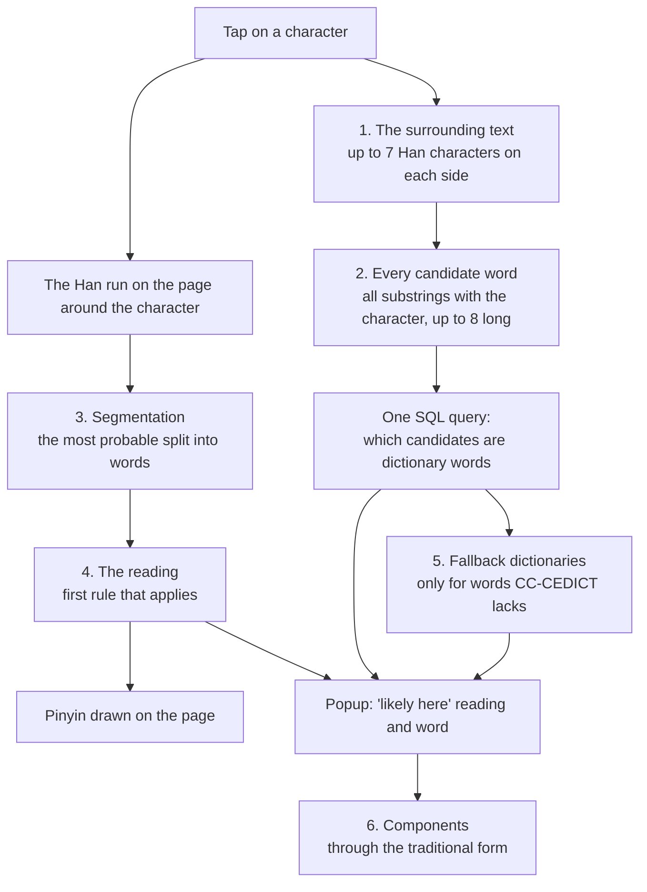

# How it works: what a tap computes

An ordinary e-reader dictionary needs a selection. You mark a string, the dictionary looks it up,
and it either has that string or it doesn't. For Chinese, two things make that hard:

- **There are no spaces.** 他是银行行长 is one unbroken string, so you have to decide where the
  word starts and ends before you can look it up. Select one character too many or too few and
  you get the wrong word, or none at all.
- **Many characters have several readings.** 行 is *háng* in 银行 (bank) and 行长 (bank
  president), *xíng* in 行人 (pedestrian), and *héng* in 道行 (a monk's attainments). Even with
  the right word selected, a single-character lookup lists every reading and leaves you to
  choose.

The plugin skips the selection. A tap on a character runs the steps below, each fixing a way a
plain lookup goes wrong. Every example on this page was run through the plugin's own code
(the offline harness in `tools/plugin_runtime.py`). This page covers only the computation, not how
a tap is caught or how the nearest character is found. The last part,
[Where the knowledge comes from](#where-the-knowledge-comes-from), covers the data the steps run
on: corpus statistics, learned rules and checked corrections.

## 1. The surrounding text

**The failure.** A dictionary that sees only the selected character cannot know that 行 sits in
行长. Everything after this step depends on seeing the neighbours.

**The fix.** `Context.around` (`ch_context.lua`) takes up to `Text.MAX_CONTEXT` = 7 Han
characters on each side of the tapped one. Punctuation, Latin letters, digits, spaces and
paragraph breaks end the run. A line wrap doesn't: the text is read from the document, not from
the screen, so a word broken across two lines stays whole.

**Example.** In 他是银行行长。, a tap on the second 行 gives 他是银行 on the left and 长 on the
right. The 。 ends the run.

## 2. Every candidate word

**The failure.** With a manual selection, *you* guess the word's boundaries. Guess wrong and
the dictionary answers a question you didn't mean to ask, or answers nothing.

**The fix.** `Text.candidates` (`ch_text.lua`) lists every substring that contains the tapped
character, up to `Text.MAX_WORD` = 8 characters long. `DB:lookup` (`ch_db.lua`) checks them all
against CC-CEDICT in one SQL query, matching simplified or traditional forms. Nothing is
guessed: the dictionary decides which strings are words, and the popup shows the ones it finds,
longest first.

**Example.** The second 行 in 他是银行行长 gives ten candidates: 他是银行行, 他是银行行长, 是银行行,
是银行行长, 银行行, 银行行长, 行行, 行行长, 行, 行长. CC-CEDICT has two of them, 行 (*háng*, *héng*,
*xíng*) and 行长 *hángzhǎng*. (银行 isn't a candidate here: it doesn't contain the second 行.)
In 很大宛如, a tap on 宛 finds 宛, 大宛 *Dà Yuān* (an ancient kingdom) and 宛如 *wǎnrú* (just
like), so a sentence that could divide two ways shows both.

## 3. Which word is really there

**The failure.** Listing every word is not enough to choose a reading, because the words
overlap. In 很大宛如 both 大宛 and 宛如 contain 宛, and they read it differently: *Yuān* and
*wǎn*. Taking "the longest word" or "the first word found from the left" picks 大宛, which is
wrong here. The plugin's own rule before 2.25.0 (the longest word with a polyphonic character,
the most frequent on a tie) made the same kind of mistake: 到了 *dàoliǎo* ("finally") won
over 到 + 了 in 扩散到了全身, giving *liǎo* instead of *le*.

**The fix.** `Resolve.segment` (`ch_resolve.lua`) splits the whole Han run around the character
into words and picks the most probable split. The word the character lands in then decides its
reading. This is *maximum-probability segmentation*, solved with *dynamic programming*.

### The scores

Every CC-CEDICT word of 1–4 characters has a frequency, *f*: how many times it occurs per
billion words of text (from [wordfreq](https://github.com/rspeer/wordfreq)). The chance that a
randomly picked word is this one is *f* / 1,000,000,000.

If words were picked independently, the probability of a whole split would be the product of
its words' probabilities. Products of tiny numbers are awkward, so the plugin takes logarithms
instead. The logarithm turns a product into a sum: log(*a* × *b*) = log *a* + log *b*. Every
word gets the score

  score(word) = ln(*f* / 1,000,000,000)

which is negative, since *f* is less than a billion. **A split's score is the sum of its words'
scores, and the best split is the one whose sum is closest to zero.** A common word scores near
zero (是: −4.21) and a rare one far below (行长: −12.18). Two extra rules keep it sensible:

- A character that is no dictionary word at all counts as frequency 1 (score −20.72), below
  every real word.
- A dictionary word that wordfreq doesn't list counts as 10 per billion (score −18.42),
  wordfreq's lowest figure. It is a real word, but no more common than the rarest one wordfreq
  has.

### Why it isn't slow: dynamic programming

The number of ways to split a run into words of 1–4 characters grows fast: a run of 20
characters already has 283,953 splits, too many to score one by one. Dynamic programming avoids that by
building the answer from the left, one character at a time:

> **best(*k*)** = the best score for the first *k* characters.
> best(0) = 0, and for each *k*, try every possible **last word** (1–4 characters long) ending
> at character *k*:
>
>   best(*k*) = max over *L* of **best(*k* − *L*) + score(the last *L* characters)**

The idea: whatever the best split of the first *k* characters is, it ends with *some* last word.
Everything before that word must itself be the best split of what comes before it, and that is a
number already computed. So each position costs at most four additions. A 20-character run
needs about 80 instead of 283,953 whole splits. Remember which *L* won at each *k*, and the split can
be read back from the end.

### Worked table: 银行行长

These are the real scores from the database. "∅" is the empty start.

| *k* | first *k* characters | last-word choices: best(*k*−*L*) + score | best(*k*) | last word |
|---|---|---|---|---|
| 1 | 银 | ∅ + 银 = 0 + (−10.29) | −10.29 | 银 |
| 2 | 银行 | ∅ + 银行 = 0 + (−8.43) = **−8.43**; 银 + 行 = −10.29 + (−8.22) = −18.51 | −8.43 | 银行 |
| 3 | 银行行 | 银行 + 行 = −8.43 + (−8.22) = **−16.65** (行行 and 银行行 are not words) | −16.65 | 行 |
| 4 | 银行行长 | 银行 + 行长 = −8.43 + (−12.18) = **−20.61**; 银行行 + 长 = −16.65 + (−7.44) = −24.09 | −20.61 | 行长 |

Reading back from *k* = 4: the last word is 行长, then best(2) ends with 银行. The split is
**银行 | 行长**, so the first 行 reads *háng* from 银行 and the second *háng* from 行长.

### Worked table: 很大宛如, where the early leader loses

| *k* | first *k* characters | best choice | best(*k*) |
|---|---|---|---|
| 3 | 很大宛 | 很 + **大宛** = −6.29 + (−15.20) = −21.48, beating 很大 + 宛 = −27.65 | −21.48 |
| 4 | 很大宛如 | 很大 + **宛如** = −12.66 + (−12.23) = −24.89, beating 很大宛 + 如 = −21.48 + (−7.69) = −29.17 | −24.89 |

After three characters, the best split ends in 大宛. One character later, ending in 宛如 is
better, and best(4) builds on best(2), not best(3). The split is **很 | 大 | 宛如**, and 宛 reads
*wǎn*. A greedy reader going left to right would already have committed to 大宛.

### Another: 尽尽自己

In 尽尽自己的心思 (to do one's best), CC-CEDICT has 尽自 *jǐnzi* (always) as well as 自己 *zìjǐ*.
Before 2.25.0, 尽自 decided the second 尽 and drew it *jǐn*. Segmentation scores both:
尽 | 尽 | 自己 = −18.56 + (−6.45) = **−25.01**, against 尽 | 尽自 | 己 = −9.28 + (−18.42) +
(−11.03) = −38.73. 自己 wins by a wide margin. No word then decides the second 尽, so it gets its
uncertainty pair, *jìn/jǐn*.

The segmentation is computed once per run on the page and cached, so the pinyin on the page and
every popup on that page reuse it (see step 7).

## 4. Which reading

**The failure.** Even a well-chosen word doesn't always settle the reading: many characters
stand alone between words (了 after a verb, 得 before a complement), and a single-character
lookup lists every reading with nothing to say which applies.

**The fix.** `Resolve.reading` (`ch_resolve.lua`) applies the first of these that fits:

1. **A special word**: an unusual reading of a common character (单于 *chányú*), when that option
   is on.
2. **The segmented word's reading**: the word from step 3, when it has two or more characters
   and a reading in the plugin's word table (行长 → *háng*).
3. **A context rule** for the character next to it: 952 rules learned from labelled sentences
   (the CPP dataset's training split).
4. **A fallback-dictionary word**, for the 518 *uncertain* characters only (their most frequent
   reading is unreliable): a Wiktionary word around the character may pick one of its two
   likeliest readings (累世 → 累 *lěi*). It counts only if it splits no word of the segmentation
   (`Resolve.fits`), so it can never cut 自己 in two.
5. **The uncertainty pair**: for an uncertain character nothing decided, both likely readings
   (*jìn/jǐn*), or the likelier one alone, depending on the setting.
6. **The default**: the character's most frequent reading.

How often each step is right, on the CPP test split (from the README's
[Accuracy](../README.md#accuracy) section, both readings of a pair counting):

| Decided by | Examples | Right |
|---|---|---|
| A word (CC-CEDICT, pypinyin) | 6,487 | 97.9% |
| A special word | 78 | 85.9% |
| A fallback dictionary's word | 13 | 84.6% |
| A context rule | 923 | 99.9% |
| Nothing: the uncertainty pair | 545 | 99.3% |
| Nothing: the default reading | 2,208 | 96.3% |

The full rules, including neutral tones and the spoken tones of 一 and 不, are in the README's
[Readings](../README.md#readings) section.

## 5. Coverage beyond CC-CEDICT

**The failure.** One dictionary never has every word: names, slang, classical terms, recent
words. Several dictionaries, on the other hand, can give the same word conflicting entries and
bury the useful one.

**The fix.** CC-CEDICT stays authoritative. `fallbackLookup` (`main.lua`) asks the fallback
dictionaries (Wiktionary, Wikipedia titles, CBDB, the MOE dictionary, Moegirlpedia) only for
candidate words CC-CEDICT lacks. It asks them in the order you set, and once one source has a
word, the next ones aren't asked for it, so each word gets one entry. Each source's database is
queried once per tap, for all the words at once. Only Wiktionary takes part in choosing readings
(step 4, rule 4); the others add entries to the popup.

## 6. Components

**The failure.** Simplification sometimes replaced the part of a character that gives its
sound. 观 is 又 + 见, which says nothing about why it reads *guān*.

**The fix.** `Components.resolve` (`ch_components.lua`) looks up the character's components. When
the traditional form the text implies has more to say, it uses that form instead. 观's
traditional form 觀 has 雚 *guàn* as its sound component, so the popup shows "traditional 觀:
雚 *guàn* → sound" and notes the simplification, 雚 → 又.

## 7. One resolver for both

**The failure.** If the page's pinyin and the popup's "likely here" came from separate code, they
could contradict each other, and the reader couldn't tell which to trust.

**The fix.** Both come from `Resolve.reading`, run on the same page items. The pinyin above the
text comes from `Resolve.annotate`, and the popup's marked reading from `Resolve.forPopup`, which
calls `Resolve.reading` on the page's cached items at the tapped character. When pinyin is drawn
above it, `forPopup` uses that pinyin, so the two can't disagree.

## 8. Speed

All of this takes about 20 ms per tap on a Boox Go 7. Working out a page's pinyin takes about
13 ms on average, and about 56 ms on a dense page in learner mode, where every character gets
pinyin. See the README's [Speed](../README.md#speed) section for the measurements. What keeps it
fast:

- **One query per source.** All the candidate words go to CC-CEDICT in one SQL query, and each
  fallback dictionary gets at most one query per tap.
- **Segmentation fetched and cached per page.** The word frequencies for every run on the page
  are fetched in one lookup (`Resolve.prefetchRuns`), and each run's split is cached, so taps on
  the same page reuse it.
- **Page items cached per page.** The characters and their positions are collected once per page
  (`Annotator:pageItems`), and the popup resolves on that same list.
- **The sentence only on demand.** The sentence that the Translate button sends is looked up
  only when the button is pressed.

## The worked example, end to end

A tap on the second 行 in 他是银行行长。 (real output from the offline harness):

| Stage | Result |
|---|---|
| Surrounding text | 他是银行 **行** 长 (the 。 ends the run) |
| Candidates | 10: 他是银行行, 他是银行行长, 是银行行, 是银行行长, 银行行, 银行行长, 行行, 行行长, 行, 行长 |
| CC-CEDICT rows | 行 *háng*, 行 *héng*, 行 *xíng*, 行长 *hángzhǎng* |
| Segmentation of the run 他是银行行长 | 他 \| 是 \| 银行 \| 行长 (银行行长 scores −20.61, as in the table above) |
| Reading | *háng*, decided by the word 行长 (rule 2) |
| On the page | 行 is the 46th most common character, so it gets pinyin only in learner mode: 银 *yín* 行 *háng* 行 *háng* 长 *zhǎng* |
| In the popup | **行长** • 行長 *hángzhǎng* · decides 行's reading, first; then **行** *háng* · likely here, with *héng* and *xíng* below it |

## Where the knowledge comes from

The steps above are only as good as the data they look things up in. A plain lookup has one kind
of data: dictionary entries. The plugin has four kinds, and the learned and hand-made ones are
checked by measuring.

### 1. Dictionaries: which words exist

CC-CEDICT, with pypinyin's phrase list for word readings, says which strings are words and how
they are read (steps 2 and 4). The fallback dictionaries add words CC-CEDICT lacks (step 5).
This is the part an ordinary lookup also has.

### 2. Corpus statistics: how common things are

Dictionaries say what a word means, not how often it is used. The plugin takes that from
[wordfreq](https://github.com/rspeer/wordfreq): frequencies per billion words, mixed from web
pages, Google Books, news, film and TV subtitles, Wikipedia, Twitter and Jieba's wordlist. They
are used three ways:

- **Segmentation** (step 3): every CC-CEDICT word's frequency becomes its score.
- **Default readings**: a character's default is the reading its dictionary words use most,
  each word weighted by how often it appears. 行 is in far more frequent text as *xíng* (行为,
  进行, 自行车) than as *háng* (银行, 行业), so *xíng* is its default and *háng* has to be
  decided by a word.
- **Rarity ranks**, which decide which characters get pinyin at each level. These can be
  rebuilt from your own books instead (see the README's
  [Your own frequency ranks](../README.md#your-own-frequency-ranks)).

### 3. Learned rules: what the neighbours say

A word doesn't always settle a reading, so the plugin also learns from sentences whose readings
a person has labelled. The source is the [CPP polyphone dataset](https://github.com/kakaobrain/g2pM):
Chinese Wikipedia sentences, each with one character that has several readings, labelled with the
right one. Its official split is kept strictly apart: the rules are learned only from the 79,117
training sentences, and accuracy is reported only on the 10,254 test sentences.

`tools/learn_from_cpp.py` learns two things:

- **Context rules.** For each character with several readings and each character that appears
  right before or after it, it counts the readings in the sentences where no dictionary word
  already decides. A rule is kept only when it has at least 5 examples and at least 95% of them
  agree. That gives 952 rules, such as 燕 followed by 王 → *yān* (燕王, the King of Yan, not
  *yàn* "swallow"). On the test split the rules are right 99.9% of the time they apply. A few learned rules are wrong in general even though they
  fit the training sentences: 攒 after 为 was learned as *cuán* from 塔顶为攒尖顶, but 他为攒够银子
  is *zǎn*. Six of these are kept out by hand in `data/rules_exclude.tsv`, so learning again
  never brings them back.
- **How far to trust each default.** For each character it measures how often the default
  reading is right when nothing else decides. CPP deliberately has many examples of every
  reading, so it overstates the rare ones. The measured share is therefore blended with the
  share the corpus statistics predict, counted as if it were 20 more examples:

  confidence = (times the default was right + 20 × predicted share) ÷ (examples + 20)

  For a character with 10 training examples, 6 of them the default, and a predicted share of
  0.9: (6 + 18) ÷ (10 + 20) = 0.8. A character below 0.75 is listed as *uncertain* with its
  two likeliest readings (518 characters, 乐 *lè/yuè* among them). For those the plugin shows
  both readings instead of guessing (step 4, rule 5).

### 4. Checked corrections

The learned and counted data has known blind spots, so a layer of corrections sits on top, each
checked by hand or against a written source, and these win over the data below them:

- **247 overrides** (`data/overrides.tsv`): 48 character defaults and 199 word readings. These
  include the defaults of the commonest function words (的 *de*, 了 *le*, 着 *zhe*), where CPP's
  oversampling of rare readings (的 *dì*, 了 *liǎo*) would mislead. The learning script prints
  review lists of possible fixes but never applies them itself, because CPP's labels are
  sometimes wrong (it gives 黄陂 as *bēi*; the place is *Huángpí*).
- **Unusual readings of common characters**: about 300 words where a common character takes a
  reading it rarely has (单于 *chányú*, 冒顿 *mòdú*). They are found automatically: a reading used
  for under 3% of the character's text, or 10% for historical names and places. 65 are
  hand-checked, a list that always wins over the automatic one and also keeps 6 contested or wrong
  words out. A guard list stops false matches: 订单于3日发货 is 订单 + 于, not 单于.
- **83 neutral-tone fixes** (`data/neutral_tone_overrides.tsv`): words CC-CEDICT gives full
  tones that Standard Mandarin reads with a neutral syllable (喷嚏 *pēnti*). Each one comes from:
  - the 普通话水平测试 must-read neutral-tone list (37 of them)
  - a mainland dictionary-style source found online, marking the syllable as neutral (Taiwan
    sources don't count either way)
  - CC-CEDICT's own neutral reading of the word inside it (做生意 from 生意 *shēngyi*)

  With no evidence, CC-CEDICT's reading stays: a missed fix is acceptable, a wrong one isn't.

### Measured, not assumed

- **The numbers come from held-out data.** The per-step accuracy table in step 4 comes from
  CPP's test split, which no rule is learned from.
- **Ideas that measured badly were cut back.** Letting Wiktionary words override readings
  seemed sensible, but measured on CPP it broke seven readings for every one it fixed. So
  Wiktionary words now decide only for the 518 uncertain characters (step 4, rule 4).
- **A fixed regression list** of sentences with known readings (`tests/eval_cases.tsv`) is
  rerun when the reading rules change.
- **Real books, not just Wikipedia.** On the author's own books, a neural reading model (g2pW)
  was run as a second opinion, its disagreements with the plugin were grouped into patterns,
  and the top patterns were checked. The top ones were g2pW's own Taiwan readings (和 *hàn*, 时期 *qí*)
  or deliberate choices, so they changed nothing. Then 300 characters with several readings,
  drawn at random from 10 books never used for tuning, were each judged by Claude (not a person)
  against the sentence: about 98.7% had the right letters and tone (a pair of readings that
  includes the right one counting as right). The 4 real errors were fixed;
  most other differences were neutral-tone conventions (README [Accuracy](../README.md#accuracy)).

What the plugin doesn't do: it runs no model on the e-reader, and its rules were not trained on
books. Books were used to find errors and to measure accuracy, and the rules come from the
labelled CPP sentences. Everything on the e-reader is lookup tables built in advance on a
computer, which is part of why a tap takes about 20 ms.
