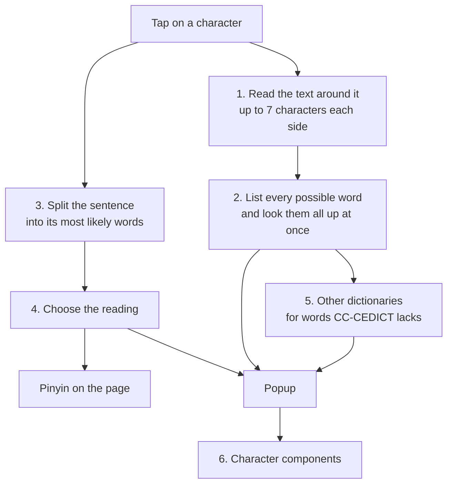

# How it works: what happens when you tap

A normal e-reader dictionary needs you to select text first. You mark a few characters, it looks
them up, and it either has them or it doesn't. Chinese makes that hard in two ways:

- **There are no spaces.** 他是银行行长 is one unbroken string, so before you can look anything up
  you have to decide where the word starts and ends. Select one character too many or too few and
  you get the wrong word, or nothing.
- **Many characters have more than one reading.** 行 is *háng* in 银行 (bank) and 行长 (bank
  president), *xíng* in 行人 (pedestrian) and *héng* in 道行 (a monk's attainments). Even when you
  select the right character, the dictionary lists every reading and leaves you to pick.

The plugin needs no selection. When you tap a character it runs the steps below, and each one
fixes a way an ordinary lookup goes wrong. Every example on this page is real output from the
plugin's own code, run on a computer. This page is about what the plugin works out, not about how
it catches the tap or finds the character you meant. The last part,
[Where the knowledge comes from](#where-the-knowledge-comes-from), covers the data all this runs
on.

## 1. Read the text around the character

A dictionary that only sees the one character you tapped can't know that this 行 is part of 行长.
So the plugin first reads up to 7 Chinese characters on each side. Punctuation, Latin letters,
digits, spaces and paragraph breaks stop it. A line break on the screen doesn't, because the
plugin reads the book's text rather than the screen, so a word split across two lines stays
whole.

In 他是银行行长。, tapping the second 行 gives 他是银行 on the left and 长 on the right. The 。
stops it there.

## 2. List every possible word

When you select text yourself, you are guessing where the word begins and ends. Guess wrong and
the dictionary answers the wrong question, or says nothing.

The plugin doesn't guess. It lists every string of up to 8 characters that contains the tapped
character, and looks them all up in CC-CEDICT in a single database query, in simplified and
traditional forms. Most of the strings aren't words, and they simply come back empty. The ones
that are words go in the popup, longest first.

Tapping the second 行 in 他是银行行长 gives ten strings: 他是银行行, 他是银行行长, 是银行行,
是银行行长, 银行行, 银行行长, 行行, 行行长, 行 and 行长. CC-CEDICT has two of them: 行 (*háng*,
*héng*, *xíng*) and 行长 *hángzhǎng*. 银行 isn't on the list, because it doesn't contain the second
行.

Tapping 宛 in 很大宛如 finds 宛, 大宛 *Dà Yuān* (an ancient kingdom) and 宛如 *wǎnrú* ("just like"),
so when a sentence could be read two ways, you see both.

## 3. Work out which word is really there

Listing the words isn't enough to choose a reading, because words overlap. In 很大宛如, both 大宛
and 宛如 contain 宛, and they read it differently: *Yuān* and *wǎn*. "Take the longest word" or
"take the first word from the left" both pick 大宛, which is wrong here. Before version 2.25.0 the
plugin had a similar rule (the longest word, or the most common one on a tie), and it made the same
kind of mistake: in 扩散到了全身 it chose the word 到了 *dàoliǎo* ("finally") and read 了 as *liǎo*,
where 到 + 了 *le* is right.

So the plugin now splits the whole stretch of text around the character into words, picks the
split that is most likely, and lets the word the character falls in decide its reading. This is
called *maximum-probability segmentation*, and it is solved with a technique called *dynamic
programming*.

### Scoring a split

Every CC-CEDICT word of 1–4 characters has a frequency, *f*: how many times it appears per
billion words of ordinary text (from [wordfreq](https://github.com/rspeer/wordfreq)). So the chance
that a word picked at random is this one is *f* ÷ 1,000,000,000.

If words were picked independently, the chance of a whole split would be its words' chances
multiplied together. Multiplying lots of tiny numbers is awkward, so the plugin uses logarithms,
which turn multiplying into adding: log(*a* × *b*) = log *a* + log *b*. Each word gets the score

  score(word) = ln(*f* ÷ 1,000,000,000)

This is always negative, because *f* is less than a billion. **A split's score is its words'
scores added up, and the best split is the one whose total is closest to zero.** A common word
scores close to zero (是: −4.21) and a rare one much lower (行长: −12.18). Two more rules:

- A single character that isn't a dictionary word counts as frequency 1 (score −20.72), below every
  real word.
- A dictionary word that wordfreq doesn't list counts as 10 per billion (score −18.42), wordfreq's
  lowest figure. It's a real word, but treated as no more common than the rarest word wordfreq has.

### Why it's fast: dynamic programming

The number of ways to split a stretch of text into words of 1–4 characters grows very quickly. A
20-character stretch already has 283,953 possible splits, far too many to score one by one.
Dynamic programming avoids that by building the answer from the left, one character at a time:

> **best(*k*)** is the best score for the first *k* characters, and best(0) = 0. For each *k*, try
> every possible **last word** (1–4 characters long) that ends at character *k*:
>
>   best(*k*) = the highest of **best(*k* − *L*) + score(the last *L* characters)**, for *L* = 1 to 4

Here's why that works. Whatever the best split of the first *k* characters is, it ends with *some*
last word. Everything before that word must itself be the best split of the characters before it,
and that number has already been worked out. So each position takes at most four additions, about
80 for a 20-character stretch instead of 283,953 whole splits. If you note which last word won at
each step, you can read the full split back from the end.

### Worked example: 银行行长

These are the real scores from the database. "∅" means nothing yet, the start of the text.

| *k* | first *k* characters | choices for the last word: best(*k*−*L*) + score | best(*k*) | last word |
|---|---|---|---|---|
| 1 | 银 | ∅ + 银 = 0 + (−10.29) | −10.29 | 银 |
| 2 | 银行 | ∅ + 银行 = 0 + (−8.43) = **−8.43**; 银 + 行 = −10.29 + (−8.22) = −18.51 | −8.43 | 银行 |
| 3 | 银行行 | 银行 + 行 = −8.43 + (−8.22) = **−16.65** (行行 and 银行行 aren't words) | −16.65 | 行 |
| 4 | 银行行长 | 银行 + 行长 = −8.43 + (−12.18) = **−20.61**; 银行行 + 长 = −16.65 + (−7.44) = −24.09 | −20.61 | 行长 |

Reading back from *k* = 4: the last word is 行长, and the best split of the first two characters
ends with 银行. So the split is **银行 | 行长**: the first 行 reads *háng* because of 银行, and the
second *háng* because of 行长.

### Worked example: 很大宛如, where the early leader loses

| *k* | first *k* characters | best choice | best(*k*) |
|---|---|---|---|
| 3 | 很大宛 | 很 + **大宛** = −6.29 + (−15.20) = −21.48, beating 很大 + 宛 = −27.65 | −21.48 |
| 4 | 很大宛如 | 很大 + **宛如** = −12.66 + (−12.23) = −24.89, beating 很大宛 + 如 = −21.48 + (−7.69) = −29.17 | −24.89 |

After three characters, the best split ends in 大宛. One character later, a split ending in 宛如 is
better, and it builds on the first two characters, not the first three. The split is
**很 | 大 | 宛如**, and 宛 reads *wǎn*. A reader that commits to words left to right would already
have taken 大宛.

### One more: 尽尽自己

In 尽尽自己的心思 ("to do one's best"), CC-CEDICT has 尽自 *jǐnzi* ("always") as well as 自己 *zìjǐ*.
Before version 2.25.0, 尽自 decided the second 尽 and the plugin drew *jǐn*. With segmentation, the
two splits score 尽 | 尽 | 自己 = −18.56 + (−6.45) = **−25.01** and 尽 | 尽自 | 己 = −9.28 + (−18.42) +
(−11.03) = −38.73. 自己 wins easily. That leaves no word to decide the second 尽, so the plugin
shows both of its likely readings, *jìn/jǐn*.

The split is worked out once for each stretch of text on the page and then kept, so the pinyin and
every popup on that page reuse it (see step 7).

## 4. Choose the reading

Even the right word doesn't always settle a reading. Many characters stand on their own between
words, like 了 after a verb or 得 before a complement, and a dictionary lookup of a single
character lists every reading without saying which one applies here.

The plugin goes down this list and uses the first rule that fits:

1. **A special word**: a rare reading of a common character, such as 单于 *chányú*, when that
   option is on.
2. **The word from step 3**, when it has two or more characters and a known reading (行长 → *háng*).
3. **A context rule** about the character right next to it. There are 952, learned from sentences
   whose readings people have labelled (see [Learned rules](#3-learned-rules-what-the-neighbours-say)).
4. **A word from another dictionary**, only for the 518 characters whose usual reading can't be
   trusted. A Wiktionary word around the character can pick one of its two likeliest readings
   (累世 → 累 *lěi*), but only if it doesn't cut across a word from step 3, so it can never split
   自己 in two.
5. **Both likely readings**, for one of those 518 characters when nothing else decided (*jìn/jǐn*).
   A setting can show just the likelier one instead.
6. **The character's most common reading.**

How often each rule is right, on test sentences the rules were never learned from (from the
README's [Accuracy](README.md#accuracy) section; when both readings are shown, it counts as right
if either one is):

| Decided by | Examples | Right |
|---|---|---|
| A word (CC-CEDICT, pypinyin) | 6,487 | 97.9% |
| A special word | 78 | 85.9% |
| A word from another dictionary | 13 | 84.6% |
| A context rule | 923 | 99.9% |
| Nothing: both readings shown | 545 | 99.3% |
| Nothing: the most common reading | 2,208 | 96.3% |

The full rules, including neutral tones and how 一 and 不 change tone in speech, are in the
README's [Readings](README.md#readings) section.

## 5. Use other dictionaries, but only to fill gaps

No single dictionary has every word: names, slang, classical terms and new words slip through. But
piling several dictionaries together brings its own problem: they can give the same word
conflicting entries and bury the useful one.

So CC-CEDICT always comes first. The other dictionaries (Wiktionary, Wikipedia titles, CBDB, the
MOE dictionary and Moegirlpedia) are only asked about words CC-CEDICT doesn't have. They are asked
in the order you set, and once one of them has a word, the rest aren't asked about it, so each
word gets one entry. Each dictionary gets a single query per tap, for all the words at once. Only
Wiktionary ever helps choose a reading (rule 4 above); the others just add entries to the popup.

## 6. Show what the character is made of

Simplification sometimes replaced the part of a character that hints at its sound. 观 is written
又 + 见, which tells you nothing about why it's read *guān*.

So when the traditional form explains more, the plugin uses it. 观's traditional form 觀 has 雚
*guàn* as its sound part, so the popup shows "traditional 觀: 雚 *guàn* → sound", and then that
simplification turned 雚 into 又.

## 7. The pinyin and the popup always agree

If the pinyin on the page and the popup's "likely here" reading came from different code, they
could disagree, and you wouldn't know which to trust.

Both use the same reading code, on the same list of characters collected from the page. When a
character already has pinyin drawn above it, the popup simply uses that reading, so the two can't
contradict each other.

## 8. Speed

All of this takes about 20 ms per tap on a Boox Go 7. Working out the pinyin for a page takes
about 13 ms on average, and about 56 ms on a dense page in learner mode, where every character gets
pinyin (see the README's [Speed](README.md#speed) section). What keeps it fast:

- **One query per dictionary.** All the possible words go to CC-CEDICT in one query, and each
  other dictionary gets at most one query per tap.
- **Work done once per page.** The word frequencies for all the text on a page are fetched in one
  go, each stretch is split once, and the characters and their positions are collected once. Taps
  on that page reuse all of it.
- **The sentence only when needed.** The sentence the Translate button sends is only looked up when
  you press the button.

## The whole thing, for one tap

Tapping the second 行 in 他是银行行长。 (real output from the plugin's code):

| Step | Result |
|---|---|
| The text around it | 他是银行 **行** 长 (the 。 stops it) |
| Possible words | 10: 他是银行行, 他是银行行长, 是银行行, 是银行行长, 银行行, 银行行长, 行行, 行行长, 行, 行长 |
| Found in CC-CEDICT | 行 *háng*, 行 *héng*, 行 *xíng*, 行长 *hángzhǎng* |
| Split of 他是银行行长 | 他 \| 是 \| 银行 \| 行长 (银行行长 scores −20.61, as in the table above) |
| Reading | *háng*, decided by the word 行长 (rule 2) |
| On the page | 行 is the 46th most common character, so it gets pinyin only in learner mode: 银 *yín* 行 *háng* 行 *háng* 长 *zhǎng* |
| In the popup | **行长** • 行長 *hángzhǎng* · decides 行's reading, first; then **行** *háng* · likely here, with *héng* and *xíng* below it |

## Where the knowledge comes from

The steps above are only as good as the data behind them. An ordinary lookup has one kind of data:
dictionary entries. The plugin has four, and the learned and hand-made ones have all been checked
by measuring.

### 1. Dictionaries: which words exist

CC-CEDICT, together with pypinyin's list of word readings, says which strings are words and how
they're read (steps 2 and 4). The other dictionaries add words CC-CEDICT doesn't have (step 5).
This is the part an ordinary lookup has too.

### 2. Word counts: how common things are

A dictionary tells you what a word means, not how often it's used. The plugin gets that from
[wordfreq](https://github.com/rspeer/wordfreq), which counts words per billion across web pages,
Google Books, news, film and TV subtitles, Wikipedia, Twitter and Jieba's word list. The counts
are used in three ways:

- **Splitting text into words** (step 3): each CC-CEDICT word's frequency becomes its score.
- **Each character's usual reading**: the reading its dictionary words use most, with each word
  weighted by how often it appears. 行 is *xíng* in far more of what people read (行为, 进行,
  自行车) than it is *háng* (银行, 行业), so *xíng* is its usual reading and *háng* has to come from
  a word.
- **How rare each character is**, which decides which characters get pinyin at each level. You can
  rebuild these ranks from your own books (see
  [Your own frequency ranks](README.md#your-own-frequency-ranks) in the README).

### 3. Learned rules: what the neighbours say

A word doesn't always settle a reading, so the plugin also learns from sentences whose readings
people have labelled. The source is the [CPP dataset](https://github.com/kakaobrain/g2pM): sentences
from Chinese Wikipedia, each with one character that has several readings, labelled with the right
one. The dataset comes already divided into a training part and a test part, and they are kept
strictly apart: the rules are learned only from the 79,117 training sentences, and accuracy is only
ever measured on the 10,254 test sentences.

Two things are learned:

- **Context rules.** For each character with several readings, the plugin looks at the character
  just before or after it and counts which reading it has, in sentences where no dictionary word
  already decides. A rule is kept only if there are at least 5 examples and at least 95% of them
  agree. That gives 952 rules, such as 燕 followed by 王 → *yān* (燕王, the King of Yan, not *yàn*
  "swallow"). On the test sentences, the rules are right 99.9% of the time they apply.

  A few learned rules fit the training sentences but are wrong in general. 攒 after 为 was learned
  as *cuán* from 塔顶为攒尖顶, but in 他为攒够银子 it's *zǎn*. Six rules like this are blocked by
  hand, so relearning never brings them back.
- **How far to trust each character's usual reading.** The plugin measures how often the usual
  reading is right when nothing else decides. But CPP deliberately includes plenty of examples of
  every reading, so it makes the rare readings look more common than they are. To correct for
  that, the measured share is blended with the share the word counts predict, which is given the
  weight of 20 extra examples:

  confidence = (times the usual reading was right + 20 × predicted share) ÷ (examples + 20)

  For a character with 10 training examples, 6 of them the usual reading, and a predicted share of
  0.9: (6 + 18) ÷ (10 + 20) = 0.8. A character that scores below 0.75 is marked *uncertain*, along
  with its two likeliest readings. 518 characters are, 乐 *lè/yuè* among them, and for those the
  plugin shows both readings rather than guessing (step 4, rule 5).

### 4. Corrections checked by hand or against a source

Learned and counted data has blind spots, so a layer of corrections sits on top. Each was checked
by hand or against a written source, and they win over everything underneath:

- **247 fixed readings**: 48 characters' usual readings and 199 words' readings. They include the
  commonest little words such as 的 *de*, 了 *le* and 着 *zhe*, where CPP's extra examples of rare
  readings (的 *dì*, 了 *liǎo*) would mislead. The learning script suggests fixes but never applies
  them itself, because CPP's labels are sometimes wrong: it gives 黄陂 as *bēi*, but the place is
  *Huángpí*.
- **Rare readings of common characters**: about 300 words where a common character takes a reading
  it rarely has, such as 单于 *chányú* and 冒顿 *mòdú*. They're found automatically, as readings used
  in under 3% of the character's appearances (10% for historical names and places). A hand-checked
  list of 65 always wins over the automatic list, and it also leaves out 6 that are disputed or
  wrong. A separate check stops false matches: in 订单于3日发货 it's 订单 + 于, not 单于.
- **83 neutral tones**: words CC-CEDICT gives full tones, but which standard Mandarin says with a
  neutral syllable, such as 喷嚏 *pēnti*. Each one comes from one of these:
  - the official list of words with neutral tones for the Mandarin proficiency test
    (普通话水平测试), which covers 37 of them
  - a mainland dictionary found online that marks the syllable as neutral (Taiwan sources don't
    count either way)
  - CC-CEDICT's own neutral reading of a word inside it (做生意 from 生意 *shēngyi*)

  Without that evidence, CC-CEDICT's reading stays. Missing a fix is acceptable; making a wrong one
  isn't.

### Measured, not assumed

- **The accuracy figures come from test sentences the rules never saw.** That includes the table
  in step 4.
- **Ideas that measured badly were cut back.** Letting Wiktionary words override readings seemed
  sensible, but when measured it broke seven readings for every one it fixed. So Wiktionary now
  only helps for the 518 uncertain characters (step 4, rule 4).
- **A fixed set of test sentences** with known readings is rerun whenever the reading rules change.
- **Real books, not just Wikipedia.** On the author's own books, a separate AI reading model
  (g2pW) was run as a second opinion, and the places where it disagreed with the plugin were
  grouped and the biggest groups checked. They turned out to be g2pW using Taiwan readings (和
  *hàn*, 时期 *qí*) or choices the plugin makes on purpose, so nothing changed. Then 300 characters
  with several readings, picked at random from 10 books that were never used for tuning, were each
  judged by Claude (not a person) against their sentence. About 98.7% were right, counting both
  readings shown with one of them correct, and differences that are only a matter of neutral-tone
  convention. The other 4 were real errors, and have been fixed (see [Accuracy](README.md#accuracy)
  in the README).

What the plugin doesn't do: it runs no AI model on the e-reader, and its rules weren't learned from
books. The books were used to find mistakes and to measure accuracy; the rules come from the
labelled CPP sentences. Everything on the e-reader is lookup tables built in advance on a computer,
which is part of why a tap takes only about 20 ms.

## Where to find it in the code

| Step | Code |
|---|---|
| 1. The text around the character | `Context.around` in `ch_context.lua` (up to `Text.MAX_CONTEXT` characters) |
| 2. Every possible word | `Text.candidates` in `ch_text.lua` (up to `Text.MAX_WORD`), `DB:lookup` in `ch_db.lua` |
| 3. Splitting into words | `Resolve.segment` and `Resolve.prefetchRuns` in `ch_resolve.lua` |
| 4. Choosing the reading | `Resolve.reading` and `Resolve.fits` in `ch_resolve.lua` |
| 5. Other dictionaries | `fallbackLookup` in `main.lua` |
| 6. Components | `Components.resolve` in `ch_components.lua` |
| 7. Pinyin and popup | `Resolve.annotate` and `Resolve.forPopup` in `ch_resolve.lua`, `Annotator:pageItems` in `ch_annotator.lua` |
| Learned rules | `tools/learn_from_cpp.py`; blocked rules in `data/rules_exclude.tsv` |
| Corrections | `data/overrides.tsv`, `data/neutral_tone_overrides.tsv` |
| Test sentences | `tests/eval_cases.tsv` |
| Running examples on a computer | `tools/plugin_runtime.py` |
